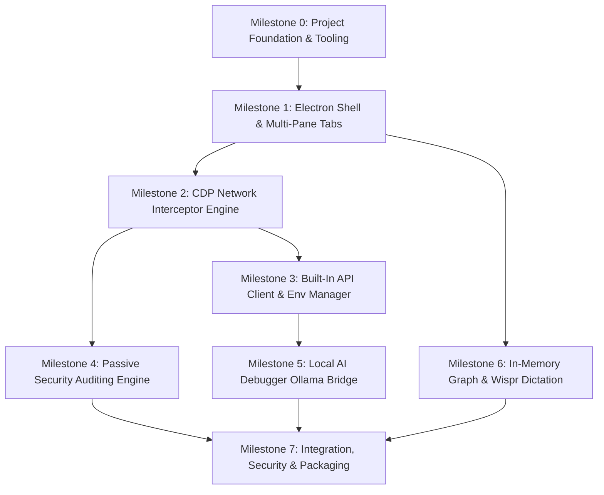

# Dev Browser — Implementation Plan & Environmental Assessment

**Document Version:** 1.0.0  
**Status:** Approved Implementation Blueprint  
**Target Hardware:** Apple MacBook Air M4 (16 GB Unified Memory)  
**Host Environment:** macOS 26.2 (Darwin arm64), Node.js v26.8.2, npm 11.19.1, Ollama (Active daemon with `qwen2.5-coder:7b`)  
**Companion Documents:**  
* [docs/PRD.md](file:///Users/mahir/Downloads/DevBrowser/docs/PRD.md)  
* [docs/ARCHITECTURE_DECISIONS.md](file:///Users/mahir/Downloads/DevBrowser/docs/ARCHITECTURE_DECISIONS.md)  
* [docs/ROADMAP.md](file:///Users/mahir/Downloads/DevBrowser/docs/ROADMAP.md)  

---

## 1. Environmental Inspection & Host Assessment

An exhaustive diagnostic inspection of the local development environment was performed on October 29, 2026. The empirical findings are recorded below:

### 1.1 Host Hardware & Operating System
* **Operating System:** macOS 26.2 (Darwin Kernel Version, Build 25C56, Architecture: `arm64` / Apple Silicon).
* **System Hardware:** Apple Silicon M4 with hardware-accelerated Metal GPU and Apple Neural Engine.
* **Unified Memory:** `hw.memsize: 17,179,869,184 bytes` (exactly 16.0 GB Unified RAM).
* **Process Budget Ceiling:** Total unified memory is shared dynamically between the OS, GPU, Electron Main/Renderer runtimes, and local AI model weights. Dev Browser must strictly operate under a **2.5 GB application ceiling** during heavy multi-tab development workloads.

### 1.2 Runtimes & Package Managers
* **Node.js:** `v26.8.2` installed (`/usr/local/bin/node` or nvm/system path).
* **Package Manager:** `npm` version `11.19.1` installed.
* **Alternative Package Managers:** `pnpm`, `yarn`, `bun` are **not installed** on this host.  
  * *Policy:* All dependency management, script execution, and lockfiles will standardize strictly on `npm` (`package-lock.json`).

### 1.3 Local AI Inference Subsystem (Ollama)
* **Ollama Executable:** `/usr/local/bin/ollama` present.
* **Daemon Status:** **Active and Running** (`/Applications/Ollama.app/Contents/Resources/ollama serve` running under user `mahir`).
* **Endpoint Verification:** `http://127.0.0.1:11434/api/tags` responded with HTTP 200 OK:
  * **Installed Model:** `qwen2.5-coder:7b` (Model Digest: `dae161e27b0e`, Size: 4.68 GB, Format: GGUF, Quantization: `Q4_K_M`, Context Length: 32,768 tokens, Families: `qwen2`).
  * *Status:* Perfectly matches the primary AI coding model specified in `docs/PRD.md` Section 3.5 and `docs/ARCHITECTURE_DECISIONS.md` ADR-003.

### 1.4 Git Repository State & Workspace Files
* **Git Status:** Directory is **not yet a git repository** (`fatal: not a git repository`).
* **Existing Files:**
  * `docs/PRD.md` (Product Requirements Document)
  * `docs/ARCHITECTURE_DECISIONS.md` (Architecture Decision Records)
  * `docs/ROADMAP.md` (Product & Engineering Roadmap)
* **Code State:** Clean greenfield state. No conflicting source files, legacy code, or uncommitted work.

---

## 2. Gap Analysis: Repository vs docs/PRD.md

| PRD Module | PRD Specification | Current Repo State | Implementation Gap |
| :--- | :--- | :--- | :--- |
| **Project Foundation** | Electron + React 18/19 + TypeScript strict | Only documentation in `docs/` | `package.json`, `tsconfig.json`, Vite build configs, Electron scaffolding missing. |
| **Tabs & Profiles** | Multi-pane split views, Container partitions | Architecture specified | Window manager, `session.fromPartition()` store, Tab UI missing. |
| **Network & API** | CDP interception, 1-click conversion, Env vars | Architecture specified | CDP event listener (`Network.enable`), REST client, Monaco JSON editor missing. |
| **Passive Security** | 11 OWASP passive rules, evidence log, SARIF | Architecture specified | Rule evaluation engine, evidence compiler, Security Drawer UI missing. |
| **Local AI Engine** | Ollama local inference (`qwen2.5-coder:7b`) | Daemon active; Model loaded | IPC bridge to `localhost:11434`, prompt sanitizer, chat UI missing. |
| **API Graph** | In-memory graph (MVP), TigerGraph adapter | Interface specified | `InMemoryGraphProvider`, Cytoscape.js visualizer missing. |
| **Voice Input** | Wispr Flow desktop workflow + provider contract | Interface specified | `IVoiceInputProvider` abstraction, input focus hooks missing. |
| **Privacy & Storage** | macOS Keychain encryption, SQLite storage | Architecture specified | `safeStorage` encryption wrapper, SQLite local store missing. |

---

## 3. Architecture Risks, Security Concerns & Licensing Audit

### 3.1 Architecture Risks & Hardware Guardrails (16 GB M4)
1. **Unified Memory Pressure (Swap Prevention):**
   * *Risk:* Running macOS (~4.5 GB) + Dev Browser with DevTools (~1.8 GB) + Ollama 7B (~4.7 GB) + User's Local Next.js/Docker Dev Server (~3.5 GB) totals ~14.5 GB, approaching the 16 GB threshold.
   * *Mandated Guardrails:*
     * Background tab auto-hibernation after 30 minutes of inactivity to release Chromium renderers.
     * Ollama model keep-alive set to `keep_alive: "5m"` to automatically unload weights from VRAM when AI is idle.
     * In-memory network log circular buffer capped at 5,000 entries (or 100 MB max RAM).
2. **CDP IPC High-Throughput Saturation:**
   * *Risk:* Single Page Applications streaming 200+ network requests per second can saturate the Electron IPC bridge, freezing the UI.
   * *Mitigation:* Network event batching in the Main process, flushing updates to the React Renderer at 30ms throttled intervals via `@tanstack/react-virtual`.

### 3.2 Electron Security Model & Hardening Mandates
To prevent remote web code execution from escaping the browser sandbox:
1. **`nodeIntegration: false`** strictly enforced across all webviews and tabs.
2. **`contextIsolation: true`** strictly enforced; all communication mediated via typed `contextBridge` APIs.
3. **`sandbox: true`** enabled on all untrusted web views.
4. **Content Security Policy (CSP)** for Dev Browser Internal UI:
   ```http
   default-src 'self';
   script-src 'self';
   style-src 'self' 'unsafe-inline';
   img-src 'self' data: https:;
   connect-src 'self' http://127.0.0.1:11434 http://localhost:9000 https:;
   font-src 'self';
   ```
5. **IPC Parameter Validation:** Every IPC handler must validate inbound payloads using **Zod** schemas before processing. Raw string interpolation or unvalidated object passing is prohibited.
6. **Script Execution Sandboxing:** Pre-request and test assertion scripts in the API Client must execute in an isolated V8 context without access to `fs`, `net`, `child_process`, or internal Electron APIs.

### 3.3 Licensing & Open Source Compliance
All dependencies selected for Dev Browser utilize commercially permissive open-source licenses:
* **Electron:** MIT License
* **React & React-DOM:** MIT License
* **TypeScript:** Apache 2.0 License
* **Vite & Plugins:** MIT License
* **Monaco Editor (`@monaco-editor/react`):** MIT License
* **Cytoscape.js:** MIT License
* **Zustand:** MIT License
* **TanStack Virtual & Table:** MIT License
* **Zod:** MIT License
* **Lucide React:** ISC License
* **Graphlib:** MIT License
* **Ollama (External Engine):** MIT License
* *Compliance Verdict:* **100% Permissive.** No GPL, AGPL, or viral copyleft dependencies are utilized.

### 3.4 External Credentials & Service Dependencies
* **Local AI (Ollama):** Depends on local daemon (`http://127.0.0.1:11434`). *Zero external credentials or internet connectivity required.* (Verified present on host).
* **TigerGraph Provider:**
  * MVP uses `InMemoryGraphProvider` with zero external dependencies.
  * Subsequent TigerGraph REST++ adapter requires user-configured cluster URL and API token.
* **Wispr Flow:**
  * MVP uses Wispr Flow macOS Desktop application with zero API keys or external credentials.
  * Subsequent Voice Interface API requires user-supplied API key.

---

## 4. Phased Implementation Roadmap & Dependency Ordering

The implementation is structured into sequential milestones where each layer builds strictly upon verified lower-level contracts:



---

## 5. Step-by-Step Execution Plan

### Milestone 0: Clean Project Initialization & Tooling Setup

#### Objectives
1. Initialize local Git repository with proper `.gitignore`.
2. Configure `package.json` with strict dependencies, scripts, and build targets.
3. Configure TypeScript (`tsconfig.json`, `tsconfig.node.json`, `tsconfig.web.json`).
4. Set up Vite configuration for Electron Main, Preload, and React Renderer (`vite.config.ts`).
5. Configure Vitest for automated unit testing.

#### Exact Commands
```bash
# 1. Initialize Git repository
git init

# 2. Initialize package.json with exact scripts and metadata
cat << 'EOF' > package.json
{
  "name": "dev-browser",
  "version": "0.1.0",
  "description": "Commercial Desktop Browser for Software Developers",
  "main": "dist/main/index.js",
  "author": "Dev Browser Team",
  "license": "UNLICENSED",
  "private": true,
  "scripts": {
    "dev": "vite",
    "build": "tsc && vite build",
    "preview": "vite preview",
    "test": "vitest run",
    "test:watch": "vitest",
    "test:coverage": "vitest run --coverage",
    "lint": "eslint src --ext .ts,.tsx",
    "typecheck": "tsc --noEmit",
    "start": "electron ."
  }
}
EOF

# 3. Create .gitignore
cat << 'EOF' > .gitignore
# Dependencies
node_modules/
.pnp
.pnp.js

# Build Outputs
dist/
dist-electron/
out/
build/
release/

# Testing & Coverage
coverage/
*.lcov
.nyc_output/

# Logs & Environment
npm-debug.log*
yarn-debug.log*
yarn-error.log*
.env
.env.local
.env.*.local

# Operating System & IDE
.DS_Store
*.pem
.vscode/
.idea/
*.suo
*.ntvs*
*.njsproj
*.sln
*.sw?
EOF
```

#### Core Dependencies to Install
```bash
# Production Dependencies
npm install --save \
  react@^18.3.1 \
  react-dom@^18.3.1 \
  zustand@^4.5.5 \
  zod@^3.23.8 \
  lucide-react@^0.453.0 \
  @tanstack/react-virtual@^3.10.8 \
  @tanstack/react-table@^8.20.5 \
  @monaco-editor/react@^4.6.0 \
  monaco-editor@^0.52.0 \
  cytoscape@^3.30.2 \
  graphlib@^2.1.8

# Development Dependencies
npm install --save-dev \
  electron@^33.2.0 \
  typescript@^5.6.3 \
  vite@^5.4.10 \
  vite-plugin-electron@^0.28.8 \
  vite-plugin-electron-renderer@^0.14.5 \
  @vitejs/plugin-react@^4.3.3 \
  vitest@^2.1.4 \
  @types/react@^18.3.12 \
  @types/react-dom@^18.3.1 \
  @types/node@^20.17.6 \
  @types/cytoscape@^3.21.8 \
  @types/graphlib@^2.1.12
```

---

### Milestone 1: Core Shell, Tab Management & Process Security

#### Objectives
1. Implement Electron Main process (`src/main/index.ts`) managing window lifecycles and process sandboxing.
2. Implement Preload script (`src/preload/index.ts`) exposing safe, typed APIs via `contextBridge`.
3. Create Session Partition Manager (`src/main/session/partition-manager.ts`) supporting isolated container tabs (`session.fromPartition()`).
4. Implement Credential Vault (`src/main/crypto/vault.ts`) using Electron `safeStorage` (macOS Keychain).
5. Build React Developer Workspace shell (`src/renderer/App.tsx`) with split-pane layouts, tab strip, and command palette (`Cmd+K`).

#### Acceptance & Verification Gate
* Create two container tabs (Profile A: User, Profile B: Admin). Confirm cookies and storage are 100% isolated.
* Verify `safeStorage.isEncryptionAvailable()` returns `true` on macOS.

---

### Milestone 2: CDP Network Interceptor Engine

#### Objectives
1. Implement `CDPNetworkInterceptor` (`src/main/network/cdp-interceptor.ts`) attaching to `webContents.debugger`.
2. Listen to `Network.enable`, `Network.requestWillBeSent`, `Network.responseReceived`, and `Network.loadingFinished`.
3. Intercept request bodies, response headers, status codes, timing metrics, and response bodies up to 10 MB.
4. Implement ring buffer queue (`src/main/network/ring-buffer.ts`) capping memory at 5,000 requests.
5. Build virtualized Network Inspector table (`src/renderer/components/network/NetworkTable.tsx`) with instant regex search and status filtering.

#### Acceptance & Verification Gate
* Navigate to any dynamic web application. Verify 100% of XHR/fetch transactions appear in the table with exact status codes and bodies.
* Export network traffic to standard HAR 1.2 format with sensitive header redaction.

---

### Milestone 3: Built-In API Client & Environment Manager

#### Objectives
1. Implement "Open in API Client" action, cloning captured network transactions into editable request drafts.
2. Build REST API Client UI (`src/renderer/components/api-client/`) with Monaco JSON editor, query param editor, and header controls.
3. Implement Environment Manager (`src/main/env/env-manager.ts`) with syntax interpolation (`{{variableName}}`).
4. Implement Post-Response Token Extraction (e.g., `data.token -> {{authToken}}`).
5. Implement Postman Collection v2.1 import and export parser (`src/shared/importers/postman.ts`).

#### Acceptance & Verification Gate
* Clone an intercepted `POST` request, modify JSON body, send request, and verify response parity.
* Run a chained workflow where Request A extracts a Bearer token and Request B uses `{{bearerToken}}`.

---

### Milestone 4: Passive Web Security Auditing Engine

#### Objectives
1. Implement `PassiveSecurityAuditor` (`src/main/security/auditor.ts`) hooked into CDP `Network.responseReceived`.
2. Implement the 11 baseline OWASP rules:
   * `SEC-HDR-001` (Strict CSP)
   * `SEC-HDR-002` (HSTS)
   * `SEC-HDR-003` (Permissive CORS)
   * `SEC-HDR-004` (Clickjacking)
   * `SEC-CK-001` (Cookie Secure flag)
   * `SEC-CK-002` (Auth Cookie HttpOnly flag)
   * `SEC-CK-003` (Cookie SameSite flag)
   * `SEC-LEAK-001` (Sensitive Token in URL)
   * `SEC-LEAK-002` (Server Version Disclosure)
   * `SEC-DOM-001` (Dangerous DOM Sinks)
   * `SEC-TLS-001` (Mixed Content)
3. Build Security Findings Drawer (`src/renderer/components/security/SecurityDrawer.tsx`) with severity badges, raw header evidence, and remediation snippets.
4. Implement SARIF v2.1.0 report exporter (`src/shared/security/sarif-exporter.ts`).

#### Acceptance & Verification Gate
* Load test pages with missing CSP and insecure cookies. Confirm findings register within 500ms with exact raw evidence snippets.
* Confirm zero synthetic attack traffic is transmitted across the network.

---

### Milestone 5: Local AI Inference (Ollama) & Wispr Flow Integration

#### Objectives
1. Implement `OllamaClient` (`src/main/ai/ollama-client.ts`) communicating with `http://127.0.0.1:11434`.
2. Connect to the host's existing `qwen2.5-coder:7b` model with `keep_alive: "5m"`.
3. Implement Context Compiler: sanitize tokens/PII, extract error stack traces and failing network bodies, and format structured prompts.
4. Build AI Assistant Side-Panel (`src/renderer/components/ai/AIAssistant.tsx`) with streaming markdown, syntax highlighting, and unified diff generator.
5. Implement `IVoiceInputProvider` abstraction (`src/shared/voice/voice-provider.ts`) and configure Monaco/input fields for seamless native Wispr Flow macOS desktop dictation.
6. Implement `InMemoryGraphProvider` (`src/main/graph/in-memory-provider.ts`) and Cytoscape.js canvas showing real-time pulsing network traffic.

#### Acceptance & Verification Gate
* Click "Explain with AI" on a simulated console exception. Confirm diagnosis streams within 3 seconds using the local Ollama daemon.
* Trigger Wispr Flow dictation into the API Client editor. Verify transcribed text inserts cleanly.

---

### Milestone 6: Hardware Performance Hardening & Testing

#### Objectives
1. Implement Tab Hibernation Manager (`src/main/session/hibernation.ts`): hibernate tabs inactive for > 30 minutes.
2. Implement memory profiling hooks: monitor RSS and dispatch warnings if app exceeds 2.2 GB RAM.
3. Implement "Nuclear Shred" command: securely wipe SQLite databases and Keychain credentials.
4. Run full unit and integration test suites using Vitest.

---

## 6. Comprehensive Testing Strategy

### 6.1 Unit Testing (Vitest)
* **Coverage Target:** Minimum 85% branch coverage on core domain logic.
* **Core Test Suites:**
  * `test/security/rules.test.ts`: Verify all 11 security audit rules against positive and negative HTTP header/cookie fixtures.
  * `test/network/cdp-parser.test.ts`: Test parsing of HTTP/1.1, HTTP/2, WebSocket frames, and multipart form bodies.
  * `test/api-client/interpolation.test.ts`: Test `{{variable}}` substitution, nested variables, and secret masking.
  * `test/ai/prompt-sanitizer.test.ts`: Test token masking, credit card redaction, and stack trace pruning.
  * `test/graph/in-memory-graph.test.ts`: Test node/edge upsertion and downstream dependency traversal.

### 6.2 Hardware Budget & Stress Testing (MacBook Air M4)
* **Cold Launch Benchmark:** Measure time from `app.whenReady()` to renderer first paint (Target: < 2.2 seconds).
* **Memory Pressure Benchmark:** Open 10 complex tabs (e.g., GitHub, Next.js docs, local app), generate 2,000 network requests, run a 7B Ollama query. Verify total memory footprint remains < 7.5 GB combined (Dev Browser + Ollama).
* **UI Responsiveness Benchmark:** Scroll virtualized network table containing 5,000 rows while streaming 50 req/sec; verify frame rate stays at 60 FPS.

---

## 7. Rollback & Disaster Recovery Procedures

| Scenario | Detection Trigger | Rollback / Recovery Action |
| :--- | :--- | :--- |
| **Electron Main Process Crash** | Uncaught exception in main process event loop. | Electron crash reporter catches exception; state is saved to `~/.devbrowser/crash-state.json`. Next launch presents "Restore previous session" modal. |
| **Native Module Build Failure** | `npm install` fails building native binaries against Node 26. | Fallback to pure JavaScript / WASM alternatives (e.g., `sql.js` for SQLite, Web Crypto API for cryptography). |
| **Ollama Memory Exhaustion** | System memory pressure warning or Ollama process termination. | Dev Browser catches loopback connection error, displays non-blocking banner: "Local AI temporarily paused to conserve RAM", and frees cached prompt buffers. |
| **Corrupted Local SQLite Database** | SQLite returns `SQLITE_CORRUPT` error on startup. | Automatic rotation: rename `devbrowser.db` to `devbrowser.db.corrupt.<timestamp>`, initialize fresh database, and notify user with option to restore from backup. |
| **Complete State Wipe (Nuclear Reset)** | User triggers nuclear shred or severe unrecoverable corruption. | Execute `rm -rf ~/Library/Application\ Support/DevBrowser` and clear all Dev Browser entries from macOS Keychain. Application reboots in factory state. |
