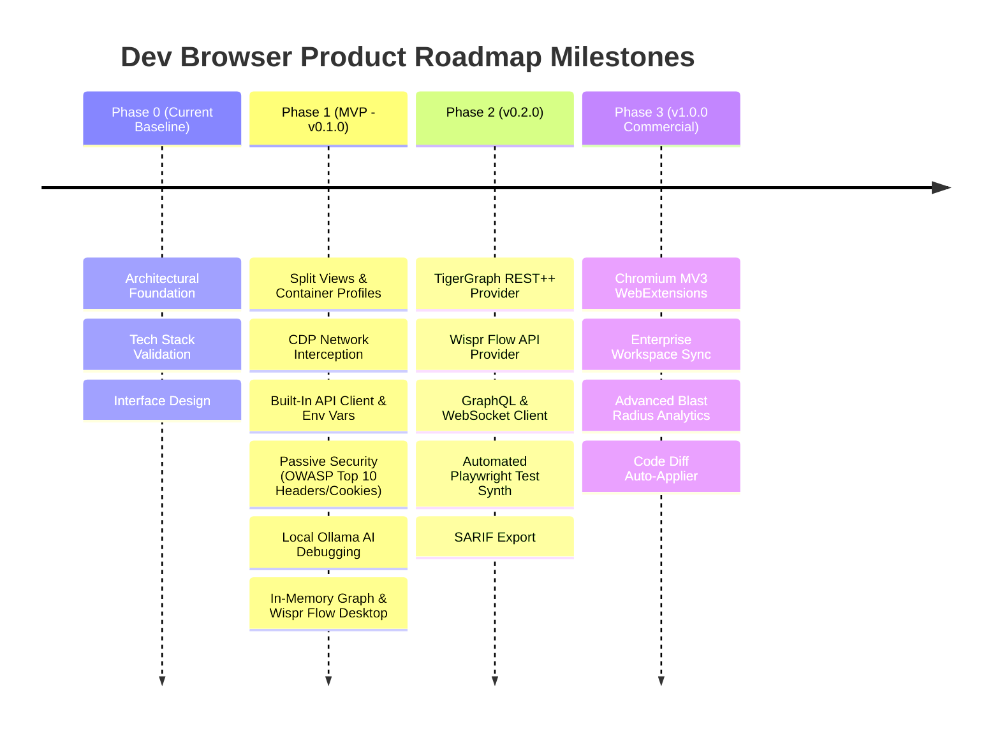

# Dev Browser — Product Requirements Document (PRD)

**Document Version:** 1.0.0  
**Status:** Approved Architectural Specification  
**Classification:** Confidential — Commercial Desktop Product  
**Target Platform:** macOS (Apple Silicon M-Series, baseline target: MacBook Air M4 with 16 GB Unified RAM)  
**Core Technologies:** Electron, React, TypeScript, Ollama (Local AI)  
**Implementation Baseline:** Pre-Implementation Specification (Distinguishing Planned MVP from Subsequent Releases)

---

## 1. Executive Summary & Vision

### 1.1 Product Vision
**Dev Browser** is a commercial desktop browser engineered exclusively for software developers, QA engineers, and security analysts. Traditional web browsers are designed for passive consumer browsing; when developers build, test, and debug modern distributed web applications, they are forced to juggle a disjointed suite of tools: consumer browsers (Chrome, Safari, Firefox), stand-alone API clients (Postman, Insomnia), terminal logs, external AI chat interfaces, and separate security audit utilities.

Dev Browser unifies these disparate workflows into a single, high-performance, local-first developer operating environment. By combining an enterprise-grade Chromium web engine with an integrated network interception engine, a built-in API client, real-time passive security auditing, a local AI debugging assistant (powered by Ollama), and an API dependency graph provider architecture (supporting TigerGraph and local in-memory engines), Dev Browser eliminates workflow context switching while strictly protecting intellectual property through zero-cloud-leakage local processing.

### 1.2 Hardware Profile & System Constraints
The reference development and execution target is an **Apple MacBook Air M4 with 16 GB Unified Memory**:
* **Total System RAM:** 16 GB Unified Memory (shared dynamically across macOS, GPU, Electron Main/Renderer processes, Chromium WebContents, and the local AI engine).
* **System OS & Background Reserve:** ~4.5 GB reserved for macOS Sequoia, window management, and background developer tools (IDE, Docker, Terminal).
* **Dev Browser Process Budget:** Max 2.5 GB RAM under heavy multi-tab developer workloads (split views, DevTools, network logs).
* **Local AI Inference Budget (Ollama):** Max 5.5 GB RAM for local quantized model weights and context memory (e.g., 4-bit quantized 7B/8B parameter models such as Qwen2.5-Coder-7B-Instruct or 3B models such as Llama 3.2 3B).
* **Safety Margin & Local Dev Server:** 3.5 GB headroom to prevent memory pressure warnings, thermal throttling, or swap thrashing.

---

## 2. Target Users, Primary Problems & User Journeys

### 2.1 Target Personas

| Persona | Role & Focus | Primary Workflow | Key Pains & Frustrations |
| :--- | :--- | :--- | :--- |
| **Persona A: Full-Stack Web Developer** ("Alex") | Builds end-to-end web apps in Next.js, Node.js, and React. | Develops frontend UI, monitors backend API responses, tests edge cases. | Constantly copies `curl` commands from browser DevTools into Postman; context-switches to ChatGPT/Claude, accidentally leaking proprietary tokens; browser tabs consume excessive RAM. |
| **Persona B: Backend & Distributed Systems Engineer** ("Priya") | Designs microservices, GraphQL/REST APIs, and database schemas. | Verifies endpoint contracts, manages auth tokens, maps upstream/downstream service impacts. | Struggles to visualize how browser actions trigger cascades across 15 microservices; lacks real-time dependency insight; env variable management between environments is error-prone. |
| **Persona C: Application Security Engineer / DevSecOps** ("Marcus") | Audits web applications for security vulnerabilities, OWASP Top 10, and compliance. | Reviews HTTP headers, CORS policies, cookie flags, CSP rules, and token handling. | Active scanners (DAST) can corrupt local test databases or trigger rate limits; passive auditing requires clunky proxy tools (Burp Suite, OWASP ZAP) with custom SSL cert installations. |
| **Persona D: QA Automation Engineer** ("Elena") | Validates end-to-end functionality, writes Playwright/Cypress regression tests. | Executes manual exploratory tests, records network flows, writes assertion scripts. | Reproducing flaky frontend bugs requires manually compiling logs, request payloads, and console traces; writing test scripts from scratch is tedious. |

### 2.2 Primary Problems & Industry Pain Points

1. **The Context-Switching Tax:** Developers switch between browser tabs, external API tools (Postman), terminal shells, and AI chat windows upwards of 50 times per hour, causing significant cognitive load and lost productivity.
2. **Disconnected Auth & State:** Testing an authenticated API in an external tool requires manually extracting session cookies or Bearer tokens from browser DevTools storage, manually formatting them into headers, and repeating the process when tokens expire.
3. **Intellectual Property & Privacy Risks:** Commercial browser extensions and cloud-based AI tools send proprietary source code, internal API endpoints, and live production payloads to third-party cloud servers.
4. **Intrusive Security Tooling:** Traditional dynamic security scanners inject aggressive payloads that can poison local development databases. Developers lack real-time, non-invasive, evidence-based security feedback during standard development browsing.
5. **Architectural Blindness:** As frontend applications interact with complex microservice meshes, developers cannot see the downstream API dependencies or cascade blast radiuses caused by their frontend interactions.
6. **Hardware Resource Exhaustion:** Running an Electron-based browser, an Electron-based API client (e.g., Postman), an Electron-based IDE (VS Code), Docker, and AI tools on a 16 GB machine results in severe RAM swapping, UI stutter, and battery depletion.

---

### 2.3 Comprehensive User Journeys

#### Journey 1: Inspecting Live Web Traffic and Converting to Replayable API Client Requests
* **Actor:** Alex (Full-Stack Developer)
* **Goal:** Debug a failing `POST /api/v2/checkout` request, modify the payload, and test edge cases without leaving the browser.
1. Alex navigates to `http://localhost:3000/cart` in Dev Browser.
2. Alex clicks "Checkout"; the application receives an HTTP 422 Unprocessable Entity error.
3. Dev Browser's integrated bottom panel automatically captures the failed network transaction via its Chrome DevTools Protocol (CDP) session listener.
4. Alex right-clicks the transaction in the Network Inspector and selects **"Open in Dev Browser API Client"**.
5. The request opens in a split tab alongside the live web page. The URL, HTTP method, query parameters, request headers (including active session cookies), and JSON body are pre-populated.
6. Dev Browser detects that the authorization header matches the active `Dev-Local` environment profile and automatically highlights the variable `{{authToken}}`.
7. Alex modifies the JSON payload field `"quantity": -1` to `"quantity": 1`, clicks **Send**, and observes the immediate 200 OK response with syntax-highlighted body, timing breakdown, and response headers.
8. Alex clicks **"Save to Collection"** -> `E-Commerce API / Checkout Flow`, ensuring the team's regression test collection is up to date.

#### Journey 2: Automated Passive Security Auditing with Evidence-Based Remediation
* **Actor:** Marcus (Security Engineer) & Alex (Developer)
* **Goal:** Verify that a newly implemented admin dashboard satisfies OWASP secure headers and cookie isolation standards before deployment.
1. Alex navigates to the staging dashboard `https://staging.internal.app/admin`.
2. As the DOM loads and network requests stream, Dev Browser’s background **Passive Security Auditor** evaluates HTTP response headers, cookie flags, and DOM scripts without injecting synthetic attack vectors.
3. The Dev Browser Status Bar displays a subtle warning badge: `1 High, 2 Medium Security Findings`.
4. Alex opens the **Security Inspector** drawer.
5. Finding 1 (High): **Missing Strict Content-Security-Policy (CSP)** allowing unsafe inline script execution.
   * *Evidence:* Full HTTP response header list captured from the initial document response, highlighting the absent `Content-Security-Policy` header.
   * *Remediation snippet:* Recommended Nginx and Next.js configuration blocks formatted for copy-paste.
6. Finding 2 (Medium): **Session Cookie Missing `SameSite` & `Secure` Flags**.
   * *Evidence:* Set-Cookie header `Set-Cookie: session_id=xyz123; Path=/; HttpOnly` flagged with exact line and response ID.
7. Alex clicks **"Export Audit Report (SARIF / Markdown)"** to attach the cryptographically signed, evidence-backed finding to the GitHub Pull Request.

#### Journey 3: Air-Gapped Local AI Debugging and Automated Playwright Test Generation
* **Actor:** Elena (QA Engineer)
* **Goal:** Diagnose an uncaught JavaScript runtime exception and automatically generate a reproducible Playwright test script.
1. Elena loads a complex data grid component; an unhandled exception triggers: `TypeError: Cannot read properties of undefined (reading 'map')`.
2. Dev Browser captures the stack trace, the exact DOM element that triggered the event, and the preceding `GET /api/v1/metrics` network response which returned an unexpected `{ items: null }` payload.
3. Elena clicks the **"Ask Local AI"** button embedded directly inside the Console error card.
4. Dev Browser formats a privacy-sanitized prompt combining:
   * The exception message and minified/unminified stack trace.
   * The failing network response schema.
   * The active React component hierarchy.
5. The query is submitted to the local **Ollama** engine (running `qwen2.5-coder:7b-instruct-q4_K_M` over local UNIX socket/localhost:11434). Zero data leaves the MacBook Air.
6. Within 1.8 seconds, the Local AI assistant returns:
   * **Root Cause Diagnosis:** The frontend expects an array, but the backend returned `null` for empty states.
   * **Defensive Code Fix:** A unified diff for the React component (`const data = response.items ?? [];`).
   * **Playwright Test Script:** An automated end-to-end test mocking the null payload and asserting graceful empty-state rendering.
7. Elena clicks **"Run Test in Dev Browser"**; the browser executes the Playwright script in an ephemeral test container and confirms test passage.

#### Journey 4: Graphing Microservice Dependencies via TigerGraph Architecture
* **Actor:** Priya (Backend Engineer)
* **Goal:** Trace the cascading microservice calls triggered by the browser's `/api/v1/user/profile` page load to prevent a cascading timeout.
1. Priya opens Dev Browser in the `Staging Microservices` profile.
2. In Dev Browser Settings, the **Graph Provider** is set to `TigerGraph REST++ Provider` pointing to a local or staging cluster endpoint (`http://localhost:9000` or TigerGraph Cloud instance with Bearer token authentication).
3. As Priya interacts with the web application, Dev Browser intercepts outgoing network calls and extracts distributed tracing headers (e.g., `traceparent`, `x-request-id`, `x-b3-traceid`).
4. Dev Browser's Graph Subsystem batches upsert mutations into TigerGraph's REST++ endpoint (`POST /restpp/graph/{graph_name}`) creating vertices for `Frontend_View`, `API_Gateway`, and `Service_Endpoint`, with edges representing `CALLS` and `DEPENDS_ON`.
5. Priya switches to the **Dependency Graph Tab** inside Dev Browser.
6. The interactive visual graph highlights a critical bottleneck: the single user profile request synchronously fans out to 8 downstream microservices (`AuthService`, `BillingService`, `NotificationService`, etc.).
7. Priya runs a GSQL impact query via the integrated interface to calculate the blast radius of taking `BillingService` offline, verifying fallback cache behavior.

#### Journey 5: Context-Aware Voice Dictation via Wispr Flow Desktop Workflow
* **Actor:** Alex (Full-Stack Developer)
* **Goal:** Quickly dictate an API test assertion and generate code without switching between keyboard and mouse.
1. Alex has the **Wispr Flow** desktop application running on macOS.
2. Alex selects the Dev Browser API Client Test Script editor or the Local AI prompt bar.
3. Alex triggers the Wispr Flow activation hotkey (Fn or customized dictation shortcut).
4. Alex speaks naturally: *"Create a test that asserts the status code is 200, checks that the response time is under 250 milliseconds, and validates that the JSON body contains a valid UUID user ID."*
5. Wispr Flow processes the spoken audio through its speech model, applies auto-formatting, punctuation, and code keyword cleanup, and injects the formatted text directly into Dev Browser's focused input field.
6. For advanced workflows, Dev Browser's `IVoiceInputProvider` interface supports direct integration with Wispr Flow's Voice Interface API (WebSocket `/ws` or REST endpoint), injecting surrounding context (such as open editor code or active response headers) into Wispr Flow's `context.textbox_contents` schema to ensure 100% accurate API-specific terminology transcription.

---

## 3. Product Requirements & Detailed Functional Specifications

### 3.1 Functionality Status Classification
To maintain absolute architectural integrity, all features in this document are categorized by implementation status:
* **[IMPLEMENTED]**: Functionality present in the initial baseline repository scaffold (e.g., core configuration, architectural types, foundational documentation).
* **[PLANNED - MVP]**: Core features delivered in Milestone 1 (v0.1.0) required for a functional, highly competitive developer browser.
* **[PLANNED - SUBSEQUENT]**: Advanced enterprise and integration features scheduled for Milestone 2 (v0.2.0) and Milestone 3 (v1.0.0).
* **[OUT OF SCOPE]**: Features explicitly excluded from product scope to protect focus, performance, and legal boundaries.

---

### 3.2 Browser Tabs, Navigation, Profiles & Developer Workspace

#### 3.2.1 Tab Management & Multi-Pane Layouts
* **[PLANNED - MVP] Multi-Pane Split Views:** Developers must be able to view a web application alongside the API client, Network Inspector, or AI assistant in vertical, horizontal, or 2x2 grid configurations.
* **[PLANNED - MVP] Tab Hibernation:** Inactive tabs automatically hibernate after a configurable timeout (default: 30 minutes) to conserve RAM on 16 GB machines, preserving DOM state and scroll position.
* **[PLANNED - MVP] Pinning & Workspaces:** Tabs can be organized into persistent project workspaces (e.g., "E-Commerce App", "Internal Admin", "Auth Service"). Switching workspaces restores all open tabs, split views, and active environment profiles.
* **[PLANNED - SUBSEQUENT] Tab Audio & Media Isolation:** Individual tabs have dedicated mute toggles and background timer throttling controls.

#### 3.2.2 Multi-Profile & Container Partitioning
* **[PLANNED - MVP] Session Partitioning:** Independent browser profiles powered by Electron's `session.fromPartition(partitionName)`. Each partition maintains fully isolated:
  * HTTP cookies and session tokens.
  * LocalStorage, SessionStorage, and IndexedDB.
  * Cache storage and service workers.
* **[PLANNED - MVP] Color-Coded Container Tabs:** Visual indicators (e.g., Red for Admin, Blue for Customer, Green for Staging) allowing developers to test multi-tenant roles side-by-side in the same window without cross-contamination.
* **[PLANNED - MVP] Ephemeral / Incognito Containers:** Disposable single-tab containers that destroy all cookies, cache, and storage immediately upon closing.

#### 3.2.3 Integrated Developer Workspace
* **[PLANNED - MVP] Bottom / Side Dockable Dev Suite:** Unified panel containing:
  1. Console & Log Interceptor (color-coded, filterable by regex).
  2. Network Inspector.
  3. API Client.
  4. Security Auditor.
  5. Local AI Assistant.
  6. API Dependency Graph.
* **[PLANNED - MVP] Quick Command Palette (`Cmd+K` / `Ctrl+K`):** Fuzzy-search navigation to jump between tabs, trigger API requests, run security audits, clear caches, or change active environments.

---

### 3.3 Network Inspection, API Client, Collections & Environments

#### 3.3.1 Real-Time Network Inspection
* **[PLANNED - MVP] CDP-Based Capture:** Capture 100% of HTTP/1.1, HTTP/2, and HTTP/3 (QUIC) network transactions, including WebSocket frames, Server-Sent Events (SSE), and gRPC-web streams, using the Chrome DevTools Protocol (`Network.enable`, `Network.requestWillBeSent`, `Network.responseReceived`, `Network.loadingFinished`).
* **[PLANNED - MVP] Full Body Inspection:** Reliable capture of raw request and response bodies (JSON, FormData, GraphQL, Multipart, Protocol Buffers) without payload truncation up to 10 MB per request.
* **[PLANNED - MVP] HAR 1.2 Export / Import:** Export filtered or full network logs in standard HTTP Archive format with sensitive header redaction options.
* **[PLANNED - MVP] Filter & Search Engine:** Instant full-text search across URLs, request headers, response headers, status codes, methods, and JSON body properties.

#### 3.3.2 Built-In API Client
* **[PLANNED - MVP] One-Click Conversion:** Right-click any inspected network request to generate:
  * A fully populated, editable API client request tab.
  * Copy as `cURL` (bash/cmd).
  * Copy as `fetch` (JavaScript/TypeScript).
  * Copy as Python `requests` or Go `net/http`.
* **[PLANNED - MVP] Protocol Support:**
  * REST / HTTP (GET, POST, PUT, PATCH, DELETE, OPTIONS, HEAD).
  * GraphQL (with integrated schema explorer, auto-completion, and variable editor).
  * WebSocket interactive client (connect, send text/binary frames, monitor incoming streams).
  * gRPC / Protobuf (Planned for v0.2.0).
* **[PLANNED - MVP] Scriptable Pre-Request & Test Assertions:**
  * Sandboxed JavaScript runtime for pre-request scripts (dynamic timestamp generation, HMAC signing, hash computation).
  * Post-response assertion framework compatible with standard Chai-like syntax (`pm.test("Status is 200", () => { pm.response.to.have.status(200); });`).

#### 3.3.3 Collections & Chained Workflows
* **[PLANNED - MVP] Hierarchical Collections:** Group requests into folders with inherited authorization, pre-request scripts, and test scripts.
* **[PLANNED - MVP] Request Chaining:** Automatically extract tokens, IDs, or headers from response bodies and store them into environment variables for use in subsequent requests (e.g., `POST /auth/login` extracts `data.token` -> sets `{{bearerToken}}` -> automatically used in `GET /user/profile`).
* **[PLANNED - MVP] Postman & OpenAPI Interoperability:** Import and export standard Postman Collections (v2.1) and OpenAPI 3.0 / 3.1 specifications.

#### 3.3.4 Environment Variables & Secure Storage
* **[PLANNED - MVP] Multi-Environment Manager:** Define distinct variable scopes (`Local`, `Development`, `Staging`, `Production`).
* **[PLANNED - MVP] Syntax Interpolation:** Support `{{variableName}}` replacement across URLs, headers, query params, and request bodies.
* **[PLANNED - MVP] Secret Protection:** Variables marked as "Secret" are masked in the UI, excluded from export files, and encrypted at rest using macOS Keychain via Electron's `safeStorage` API.

---

### 3.4 Passive Web Security Auditing & Evidence-Based Findings

#### 3.4.1 Zero-Traffic Passive Audit Philosophy
* **Core Rule:** Dev Browser **never** injects fuzzing payloads, brute-force requests, SQL injection strings, or active exploit attempts into target servers. All auditing is **100% passive**, executed entirely in-memory by analyzing the HTTP requests, responses, headers, cookies, and DOM resources generated during normal developer navigation.

#### 3.4.2 Audit Rule Matrix & Check Categories

| Category | Finding ID | Rule Name | Severity | Evaluation Logic | Evidence Captured |
| :--- | :--- | :--- | :--- | :--- | :--- |
| **HTTP Headers** | `SEC-HDR-001` | Missing Content-Security-Policy | High | Response header `Content-Security-Policy` absent or contains `unsafe-inline` / `unsafe-eval` without nonces/hashes. | Exact raw response headers, URL, status code. |
| **HTTP Headers** | `SEC-HDR-002` | Missing Strict-Transport-Security (HSTS) | Medium | HTTPS response missing `Strict-Transport-Security` or `max-age` < 10368000 (120 days). | Response headers, protocol version. |
| **HTTP Headers** | `SEC-HDR-003` | Permissive CORS Configuration | High | `Access-Control-Allow-Origin: *` returned alongside `Access-Control-Allow-Credentials: true`, or reflected `Origin`. | Request Origin header vs Response CORS headers. |
| **HTTP Headers** | `SEC-HDR-004` | X-Frame-Options / Clickjacking | Medium | Absence of `X-Frame-Options: DENY\|SAMEORIGIN` and absence of CSP `frame-ancestors`. | Document response headers. |
| **Cookies** | `SEC-CK-001` | Missing `Secure` Flag | High | `Set-Cookie` issued over HTTP, or over HTTPS without the `Secure` attribute. | Exact `Set-Cookie` raw string, cookie name. |
| **Cookies** | `SEC-CK-002` | Missing `HttpOnly` on Auth Cookies | High | Cookie names matching `*session*`, `*token*`, `*auth*`, `*jwt*` without `HttpOnly` flag. | Exact `Set-Cookie` directive. |
| **Cookies** | `SEC-CK-003` | Missing / Lax `SameSite` Attribute | Medium | `Set-Cookie` missing `SameSite` attribute or explicitly set to `SameSite=None` without `Secure`. | Exact `Set-Cookie` directive. |
| **Information Leak** | `SEC-LEAK-001` | Sensitive Token in URL Query Params | High | URL query string matches patterns for API keys, AWS tokens, JWTs, or private keys (`token=`, `key=`, `secret=`). | Redacted URL string, parameter key, location. |
| **Information Leak** | `SEC-LEAK-002` | Server Version Disclosure | Low | Response header `Server` or `X-Powered-By` discloses exact software versions (e.g., `Apache/2.4.41`, `Express`). | Server response headers. |
| **DOM & Scripts** | `SEC-DOM-001` | Dangerous DOM Sink Usage | Medium | Client scripts calling `eval()`, `document.write()`, or `innerHTML` with unsanitized URL/location parameters. | Script URL, call stack, sink name, tainted argument. |
| **Transport** | `SEC-TLS-001` | Mixed Content Detection | High | Secure HTTPS page loading insecure HTTP scripts, stylesheets, or iframes. | Parent HTTPS URL, Child HTTP resource URL. |

#### 3.4.3 Evidence Schema & Export
* Every finding produces an immutable **Security Finding Object**:
  ```typescript
  interface SecurityFinding {
    id: string;                      // UUIDv4
    ruleId: string;                  // e.g. "SEC-HDR-001"
    timestamp: number;               // ISO Epoch ms
    severity: "CRITICAL" | "HIGH" | "MEDIUM" | "LOW" | "INFO";
    title: string;
    description: string;
    remediation: string;
    evidence: {
      url: string;
      method: string;
      statusCode?: number;
      requestHeaders?: Record<string, string>;
      responseHeaders?: Record<string, string>;
      rawSnippet?: string;
      cookieName?: string;
    };
    cwe: number;                     // Common Weakness Enumeration ID
    owaspCategory: string;           // e.g. "A05:2021-Security Misconfiguration"
    falsePositiveSuppressionId: string; // Hash of ruleId + urlPattern for one-click ignore
  }
  ```
* **[PLANNED - MVP] SARIF Export:** Export findings in OASIS SARIF (Static Analysis Results Interchange Format) v2.1.0 to integrate directly into GitHub Advanced Security and CI/CD pipelines.

---

### 3.5 AI Debugging, Local Inference, Code Generation & Test Assistance

#### 3.5.1 Local Inference Engine Architecture (Ollama)
* **Local-First Mandate:** All baseline AI capabilities must execute on-device using a locally running **Ollama** daemon (`http://127.0.0.1:11434` or local socket). No user source code, console logs, or network payloads are sent to third-party cloud services by default.
* **Target Hardware Optimization (MacBook Air M4 16 GB):**
  * **Primary Model:** `qwen2.5-coder:7b-instruct-q4_K_M` (~4.7 GB VRAM) — State-of-the-art coding, syntax awareness, test generation, and diff generation.
  * **Fallback / Lightweight Model:** `llama3.2:3b-instruct-q4_K_M` (~2.0 GB VRAM) — Fast response, minimal RAM footprint for low-battery or heavy-multitasking scenarios.
  * **Context Window Budget:** Configurable 8,192 to 16,384 tokens with dynamic pruning of log payloads to prevent out-of-memory (OOM) conditions.
* **[PLANNED - SUBSEQUENT] Optional BYOK Cloud Fallback:** Users may explicitly configure optional Bring-Your-Own-Key (BYOK) providers (Anthropic Claude, OpenAI, Google Gemini) for non-sensitive tasks, with strict per-workspace toggle controls.

#### 3.5.2 AI Debugging Subsystem
* **[PLANNED - MVP] One-Click Log Diagnosis:** Console errors, unhandled rejections, and HTTP 4xx/5xx network failures feature an "Explain with AI" action.
* **[PLANNED - MVP] Context Compilation Engine:** Automatically constructs a structured, token-budgeted prompt including:
  1. Complete error message and unminified stack trace (using source maps if available).
  2. Associated network request headers and payload.
  3. Preceding console breadcrumbs (last 5 log statements).
  4. User's active tech stack (detected from DOM/framework signatures: Next.js, Vite, React, Vue, Angular).
* **[PLANNED - MVP] Interactive Debugging Chat:** A persistent side-panel assistant with multi-turn conversation memory, code syntax highlighting, and one-click copy.

#### 3.5.3 Automated Code Generation & Test Assistance
* **[PLANNED - MVP] Unified Diff Generation:** The AI assistant provides actionable code patches formatted in standard `git diff` syntax.
* **[PLANNED - MVP] Playwright & Jest Test Synthesis:** Synthesizes executable automated tests directly from intercepted user interactions:
  * Elena clicks a button -> network request fires -> DOM updates.
  * Dev Browser records the event sequence.
  * AI translates the sequence into an idiomatic Playwright script with resilient data-testid selectors and network assertions.
* **[PLANNED - MVP] API Mock Generator:** Generates realistic mock JSON payloads and MSW (Mock Service Worker) handlers from observed network responses.

---

### 3.6 API Dependency Graphs & TigerGraph-Suitable Provider Architecture

#### 3.6.1 Graph Provider Architecture (`IGraphProvider`)
To support diverse developer environments—from standalone local offline development to large-scale enterprise microservice mapping—Dev Browser defines an abstract graph interface:

```typescript
export interface IGraphNode {
  id: string;                     // e.g. "service:billing", "endpoint:POST/checkout"
  type: "Service" | "Endpoint" | "Database" | "ThirdParty" | "FrontendRoute";
  name: string;
  metadata: Record<string, unknown>;
}

export interface IGraphEdge {
  sourceId: string;
  targetId: string;
  type: "CALLS" | "DEPENDS_ON" | "PRODUCES" | "CONSUMES";
  metadata: {
    protocol?: "HTTP" | "gRPC" | "GraphQL";
    averageLatencyMs?: number;
    errorRate?: number;
    callCount?: number;
    lastObserved?: string;
  };
}

export interface IGraphProvider {
  readonly providerId: string;
  readonly providerName: string;
  
  initialize(config: Record<string, unknown>): Promise<void>;
  healthCheck(): Promise<{ ok: boolean; message?: string }>;
  upsertNode(node: IGraphNode): Promise<void>;
  upsertEdge(edge: IGraphEdge): Promise<void>;
  batchUpsert(nodes: IGraphNode[], edges: IGraphEdge[]): Promise<void>;
  queryDependencies(nodeId: string, depth?: number): Promise<{ nodes: IGraphNode[]; edges: IGraphEdge[] }>;
  calculateBlastRadius(nodeId: string): Promise<{ affectedNodes: IGraphNode[]; riskScore: number }>;
  clearGraph(): Promise<void>;
}
```

#### 3.6.2 TigerGraph REST++ Provider Integration
* **Integration Reality & Verified Specs:**
  * Connects directly to TigerGraph's native **REST++ API** running on port 9000 (standard self-managed/Docker) or port 443 (TigerGraph Cloud).
  * **Authentication:** Uses TigerGraph's verified token endpoint `POST /restpp/v1/requesttoken` with Secret, injecting `Authorization: Bearer <token>` on all requests.
  * **Batch Upsert:** Utilizes standard verified endpoint `POST /restpp/graph/{graph_name}` with structured JSON payloads containing vertex and edge batches.
  * **Dependency Querying:** Runs pre-installed or dynamic GSQL queries via `GET /restpp/query/{graph_name}/{query_name}` (e.g., `GetDownstreamDependencies(vertex_id, max_hops)`).
* **[PLANNED - MVP] Local In-Memory Graph Provider:** An embedded in-memory directed graph (using Graphlib / SQLite) for standalone local development with zero external infrastructure requirements.
* **[PLANNED - SUBSEQUENT] TigerGraph Cloud & Docker Adapter:** Enterprise-grade provider connecting to TigerGraph instances, offering persistent graph analytics across entire engineering organizations.

#### 3.6.3 Graph Visualization UI
* **[PLANNED - MVP] Interactive Canvas:** Canvas/WebGL-accelerated graph view (using Cytoscape.js or Force-Graph) embedded in a browser tab.
* **[PLANNED - MVP] Live Traffic Animation:** Edges pulse in real-time when corresponding network requests are captured in the browser.
* **[PLANNED - MVP] Error Highlighting:** Nodes turn amber/red when 4xx/5xx status codes are detected, showing the propagation path of cascading microservice failures.

---

### 3.7 Voice Input & Wispr Flow Workflow Integration

#### 3.7.1 Voice Input Architecture (`IVoiceInputProvider`)
To enable hands-free developer productivity (voice-driven API testing, code dictation, and prompt entry) without coupling Dev Browser to a single proprietary vendor, Dev Browser defines a decoupled voice provider contract:

```typescript
export interface VoiceContext {
  activePanel: "API_CLIENT" | "AI_PROMPT" | "SECURITY_AUDIT" | "SEARCH";
  currentCodeSelection?: string;
  surroundingText?: {
    beforeText: string;
    selectedText: string;
    afterText: string;
  };
  detectedFramework?: string;
}

export interface VoiceTranscriptionResult {
  text: string;
  confidence: number;
  isFinal: boolean;
  durationMs: number;
}

export interface IVoiceInputProvider {
  readonly providerId: string;
  readonly providerName: string;
  
  initialize(config: Record<string, unknown>): Promise<void>;
  isAvailable(): Promise<boolean>;
  startListening(context: VoiceContext, onChunk: (result: VoiceTranscriptionResult) => void): Promise<void>;
  stopListening(): Promise<VoiceTranscriptionResult>;
  cancel(): void;
}
```

#### 3.7.2 Wispr Flow Workflows & Integration Modes
Dev Browser supports two complementary Wispr Flow workflows based on official technical capabilities:

1. **Workflow A: System-Level Wispr Flow Desktop Application Workflow (Recommended for MVP):**
   * *Mechanism:* The developer runs the official Wispr Flow macOS desktop application.
   * *Integration:* Dev Browser provides standard, accessible macOS text input fields, Monaco code editors, and command palettes configured with standard accessibility attributes (`role="textbox"`, `aria-label`).
   * *Execution:* The developer activates Wispr Flow via their standard global hotkey. Wispr Flow handles real-time audio capture, noise cancellation, AI formatting, and direct OS keystroke injection into Dev Browser's focused editor.
   * *Benefits:* Zero configuration, zero external API keys, 100% reliable, zero maintenance overhead.

2. **Workflow B: Direct Wispr Flow Voice Interface API Provider (Subsequent Release):**
   * *Mechanism:* For deep context-aware dictation, Dev Browser implements `IVoiceInputProvider` connecting to Wispr Flow's developer API.
   * *Verified API Specification:*
     * Streams 16kHz WAV audio via WebSocket (`/ws`) or sends base64-encoded audio to `/api`.
     * Passes rich developer context via the official `context` schema:
       ```json
       {
         "context": {
           "app": { "type": "code_editor" },
           "textbox_contents": {
             "before_text": "pm.test('Status is 200', () => { ",
             "selected_text": "",
             "after_text": " });"
           }
         }
       }
       ```
     * Authentication via Bearer token (`Authorization: Bearer <JWT>`).
   * *Prerequisites:* Requires an active Wispr Flow API account and API key. (Dev Browser explicitly notes that API access is subject to Wispr Flow's developer program availability).

---

### 3.8 Privacy Controls, Local Storage, Credential Handling & Deletion

#### 3.8.1 Local-First Architecture & Data Isolation
* **Zero Telemetry Default:** Dev Browser emits zero analytics, telemetry, or diagnostic events to external servers unless the user explicitly opts in.
* **Encrypted Credential Storage:**
  * All sensitive assets (API keys, Bearer tokens, TigerGraph credentials, basic auth passwords) are encrypted using Electron's `safeStorage` API, which leverages the **macOS Keychain** on Apple Silicon.
  * Plaintext credentials are never written to disk or logged to console.
* **Local SQLite Database:**
  * Network history, collections, environment profiles, and security findings are stored in an application-scoped SQLite database located in `~/Library/Application Support/DevBrowser/devbrowser.db`.
  * Optional full-database encryption via SQLCipher.

#### 3.8.2 Secure Data Deletion & Workspace Shredding
* **[PLANNED - MVP] Granular Cleanup Controls:** Users can selectively purge:
  * Cached network request/response bodies.
  * In-memory graph nodes and edges.
  * Security findings and evidence logs.
  * Stored cookies, local storage, and service workers per profile partition.
* **[PLANNED - MVP] "Nuclear Shred" Command:** Single-click purge that overwrites SQLite databases with random bytes, deletes all Keychain credentials, purges session partitions, and resets Dev Browser to a factory clean state.

---

### 3.9 Future Extension Points & Open Integration Standards
To avoid inventing brittle, vendor-proprietary plugin systems, Dev Browser builds upon proven, open developer standards:

1. **Chromium WebExtension Manifest V3 (MV3):** Support for standard browser extensions (React Developer Tools, Redux DevTools, Vue Devtools, 1Password, Bitwarden) via Electron's `session.loadExtension()` API.
2. **OpenAPI 3.0 & 3.1 Specification Import/Export:** Direct synchronization of API client collections with repository OpenAPI specs.
3. **HAR 1.2 (HTTP Archive) Standard:** Interoperable network log import and export.
4. **OASIS SARIF v2.1.0:** Universal static/passive security report format accepted by GitHub, GitLab, and Azure DevOps.
5. **Language Server Protocol (LSP):** Future extension point for Monaco code editor autocompletion in pre-request and test assertion scripts.
6. **W3C WebDriver BiDi:** Modern browser automation protocol allowing Playwright, Puppeteer, and Selenium to drive Dev Browser sessions natively.

---

## 4. Non-Functional Requirements (NFRs)

### 4.1 Performance & Hardware Budget (MacBook Air M4, 16 GB RAM)

| Metric | Threshold / Target | Verification Method |
| :--- | :--- | :--- |
| **Cold Startup Time** | < 2.2 seconds to interactive DOM | Automated benchmark timing from process launch to `did-finish-load`. |
| **Warm Window Spawn** | < 400 milliseconds | Measurement of new window / tab creation. |
| **Base App Memory (Idle)** | < 350 MB RAM (Main + 1 Renderer + UI) | macOS Activity Monitor / Node `process.memoryUsage()`. |
| **Active Dev Session Memory** | < 1.8 GB RAM (5 active tabs, DevTools, 5,000 network requests) | Continuous stress test measuring RSS memory footprint. |
| **Local AI Memory Ceiling** | < 5.2 GB RAM (Ollama running 7B Q4_K_M model) | Metal performance HUD / `ollama ps` memory tracking. |
| **Total System Headroom** | >= 4.0 GB unallocated unified RAM | Guard against macOS memory pressure warnings (`vm_stat`). |
| **UI Frame Rate** | Constant 60 FPS (ProMotion 120 FPS where available) | Chrome DevTools Frame Rendering stats; zero main-thread hitching. |
| **Network Throughput** | No degradation up to 1,000 req/sec | Benchmark comparing raw network speed vs CDP interception overhead (< 3% latency add). |

### 4.2 Accessibility (WCAG 2.1 AA Compliance)
* **Keyboard Navigation:** 100% of features (tab switching, API requests, panel docking, security audits) accessible via documented keyboard shortcuts.
* **Contrast Ratios:** Minimum 4.5:1 text-to-background contrast ratio across both Dark Mode and Light Mode developer themes.
* **Screen Reader Support:** Full ARIA role labeling (`aria-live` for streaming AI responses, `role="tablist"` for multi-tab management, `aria-expanded` for JSON trees).
* **Reduced Motion:** Respects macOS `prefers-reduced-motion` system settings by disabling non-essential UI transitions.

### 4.3 Reliability & Fault Tolerance
* **Process Crash Isolation:** If an individual web tab crashes (e.g., out-of-memory WebGL or infinite loop), the Dev Browser core UI, API client, and AI assistant remain fully operational.
* **Crash Recovery:** Automatic restoration of open tabs, unsaved API request drafts, and environment variable states following an unexpected application termination.
* **Ollama Connection Resilience:** Graceful degradation if Ollama daemon is not running; displays an informative setup prompt with one-click terminal installation commands (`ollama run qwen2.5-coder:7b`).

### 4.4 Security & Application Hardening
* **Electron Security Standards:**
  * `nodeIntegration: false` strictly enforced across all web renderers.
  * `contextIsolation: true` strictly enforced; all communication mediated via typed `contextBridge` APIs.
  * `sandbox: true` enabled on all untrusted web views.
  * Strict Content Security Policy (CSP) applied to all internal Dev Browser UI renderers (`script-src 'self'`).
* **Zero Remote Code Execution:** Sandboxed JavaScript evaluation for API client pre-request and test scripts (using Node `isolated-vm` or web worker sandbox).
* **Safe Protocol Handling:** Strict validation of all external URLs (`http://`, `https://`, `ws://`, `wss://`); absolute block on `file://` scheme loading from external web inputs.

### 4.5 Maintainability & Code Quality
* **Strict TypeScript:** `strict: true`, `noImplicitAny: true`, zero untyped `any` in core domain interfaces.
* **Modular Monorepo Structure:** Separation between Main process (Node/Electron), Renderer UI (React 18/19), Shared Domain Contracts, and Extension Adapters.
* **Automated Test Coverage:** Minimum 85% unit test coverage on core engines (Network interceptor, Security rules, API script runner, Graph transformers).

---

## 5. Release Horizons, Acceptance Criteria & Scope Matrix

### 5.1 Release Horizons



---

### 5.2 Feature Scope Matrix

| Feature Module | Baseline [IMPLEMENTED] | MVP (v0.1.0) [PLANNED] | Subsequent (v0.2.0 / v1.0.0) [PLANNED] | Explicitly Out of Scope |
| :--- | :--- | :--- | :--- | :--- |
| **Core Browser** | Spec & Architecture | Multi-pane split views, Container profiles, Tab hibernation, Cmd+K palette | Custom UI themes, WebExtension MV3 support (v1.0.0) | Proprietary rendering engine (Blink/Chromium is used) |
| **Network & API** | Type definitions | CDP interception, 1-click cURL/Fetch/Postman export, REST client, Env vars, Chaining | GraphQL schema explorer, WebSocket/SSE streaming client, gRPC support | Building a cloud-hosted Postman team clone |
| **Security Audit** | Rule contracts | 11 Passive Header, Cookie, and Leak rules; Evidence log; SARIF export | AST-based DOM sink tracing, Custom rule builder UI | Active DAST fuzzing, SQL injection payload attacks, port scanning |
| **AI Debugging** | Provider contract | Ollama integration (Qwen2.5-Coder 7B / Llama 3.2 3B), Error explainer, Diff generator | Playwright test synthesis, BYOK Cloud fallback (Claude/GPT-4) | Cloud AI lock-in, mandatory telemetry |
| **API Graph** | `IGraphProvider` spec | In-Memory Graphlib provider, live pulse visualization, dependency explorer | TigerGraph REST++ adapter, blast radius calculation, GSQL query runner | Full database administration tooling |
| **Voice Input** | `IVoiceInputProvider` spec | System Wispr Flow Desktop workflow (hotkey/input focus support) | Wispr Flow Voice Interface API integration (WebSocket/REST + context) | In-house training of speech-to-text models |
| **Data & Privacy** | Privacy architecture | Local SQLite storage, macOS Keychain `safeStorage`, Nuclear shred | Encrypted cloud team backup (zero-knowledge) | Monetizing user browsing or telemetry data |

---

### 5.3 Acceptance Criteria for MVP Release (v0.1.0)

#### AC-01: Split Workspace & Container Isolation
* Given two container tabs (Profile A: "User", Profile B: "Admin"), when the user logs into `http://localhost:3000` with different accounts, then session cookies and local storage must remain 100% isolated without cross-talk.
* Given 10 open browser tabs, when tabs remain inactive for > 30 minutes, then memory allocation for those tabs must drop by >= 60% via hibernation.

#### AC-02: Network Inspection & API Client Conversion
* Given an active browsing session on an authenticated web app, when an XHR/Fetch request completes, then Dev Browser must capture the complete URL, headers, cookies, and request/response body.
* Given an intercepted network request, when the developer clicks "Open in API Client", then all parameters, active cookies, and payload must be editable, and clicking "Send" must reproduce the identical request.
* Given an environment variable `{{apiHost}}`, when referenced in an API request URL, then Dev Browser must interpolate the active profile value accurately at runtime.

#### AC-03: Evidence-Based Passive Security Findings
* Given a target website missing `Content-Security-Policy` and returning session cookies without `SameSite`, when loaded in Dev Browser, then the Security Inspector must register `SEC-HDR-001` and `SEC-CK-003` within 500ms of page load.
* Every finding must display exact raw HTTP headers as evidence, an OWASP reference, and an actionable remediation snippet. Dev Browser must never issue unauthorized secondary requests to the server.

#### AC-04: Local AI Debugging (Ollama on M4)
* Given an unhandled JavaScript exception in the console, when the user clicks "Ask Local AI", then Dev Browser must sanitize the payload and stream an actionable diagnosis from local Ollama within 3 seconds without network egress.
* The total memory consumption of Dev Browser + Ollama (7B Q4_K_M) must not exceed 8.0 GB RAM during active inference.

#### AC-05: Wispr Flow Desktop Workflow
* Given Wispr Flow running on macOS, when the user focuses any Dev Browser input field and triggers Wispr Flow dictation, then spoken text must insert accurately with zero focus jitter or keystroke drop.

#### AC-06: Local Privacy & Deletion
* When the user triggers the "Nuclear Shred" command, all SQLite databases, cached bodies, and Keychain credentials must be permanently deleted, and the application must restart in a pristine state.

---

## 6. Document Sign-Off & Verification
This Product Requirements Document establishes the definitive operational and architectural standard for Dev Browser. All engineering implementations must strictly adhere to the interfaces, memory budgets, security constraints, and scope boundaries specified herein. Proceed to `docs/ARCHITECTURE_DECISIONS.md` for architectural blueprints and `docs/ROADMAP.md` for execution schedules.
