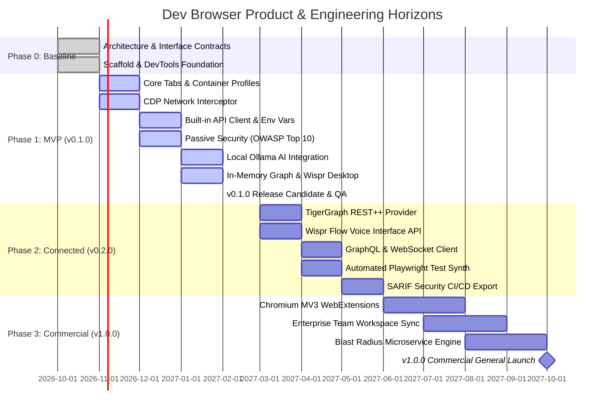
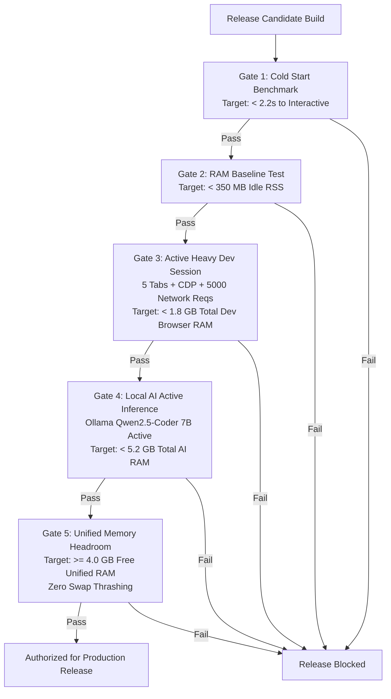

# Dev Browser — Product & Engineering Roadmap

**Document Version:** 1.0.0  
**Status:** Approved Engineering Roadmap  
**Target Hardware:** Apple MacBook Air M4 (16 GB Unified Memory)  
**Core Technologies:** Electron, React, TypeScript, Ollama (Local AI)  
**Companion Documents:** [PRD.md](file:///Users/mahir/Downloads/DevBrowser/docs/PRD.md), [ARCHITECTURE_DECISIONS.md](file:///Users/mahir/Downloads/DevBrowser/docs/ARCHITECTURE_DECISIONS.md)

---

## 1. Roadmap Executive Summary & Strategic Horizons

The Dev Browser roadmap outlines the evolutionary path from initial architectural specification to commercial desktop product. Dev Browser is built on a **local-first, privacy-by-default architecture** optimized specifically for Apple Silicon hardware (baseline target: MacBook Air M4 with 16 GB unified RAM).

### Strategic Horizons

---

## 2. Comprehensive Feature Status & Delivery Matrix

To maintain clear boundaries between implemented, planned, and out-of-scope work, all features are categorized across development phases:

| Functional Area | Feature / Capability | Delivery Phase | Implementation Status | Grounding & Dependency Notes |
| :--- | :--- | :--- | :--- | :--- |
| **System & Core** | Electron, React, TypeScript Architecture | Phase 0 | **[IMPLEMENTED]** | Fully specified in PRD & ADR documents. |
| **System & Core** | Strict Process Isolation & CSP | Phase 1 (MVP) | **[PLANNED - MVP]** | Enforces `nodeIntegration: false`, `contextIsolation: true`. |
| **System & Core** | M4 16GB RAM Budgeting & Hibernation | Phase 1 (MVP) | **[PLANNED - MVP]** | Auto-hibernates tabs inactive for > 30 mins; < 2.5 GB app ceiling. |
| **Workspace & Tabs** | Multi-Pane Split Views (Vertical/Horizontal) | Phase 1 (MVP) | **[PLANNED - MVP]** | Grid layouts for parallel browser & tool viewing. |
| **Workspace & Tabs** | Multi-Profile Container Partitioning | Phase 1 (MVP) | **[PLANNED - MVP]** | Electron `session.fromPartition()` isolated cookies/storage. |
| **Workspace & Tabs** | Ephemeral / Incognito Container Tabs | Phase 1 (MVP) | **[PLANNED - MVP]** | Zero-footprint tabs purged immediately on close. |
| **Workspace & Tabs** | Cmd+K Universal Command Palette | Phase 1 (MVP) | **[PLANNED - MVP]** | Keyboard-first navigation across all tabs, actions, and settings. |
| **Network Engine** | CDP Network Interception (`Network.enable`) | Phase 1 (MVP) | **[PLANNED - MVP]** | Captures HTTP/1.1, HTTP/2, HTTP/3, WebSocket, and SSE. |
| **Network Engine** | Full Request & Response Body Capture | Phase 1 (MVP) | **[PLANNED - MVP]** | In-memory stream capture up to 10 MB per transaction. |
| **Network Engine** | 1-Click "Open in API Client" | Phase 1 (MVP) | **[PLANNED - MVP]** | Converts live network requests into editable API client models. |
| **Network Engine** | HAR 1.2 Export with Secret Redaction | Phase 1 (MVP) | **[PLANNED - MVP]** | Standard HTTP archive format with token masking. |
| **API Client** | REST HTTP Client (GET, POST, PUT, DELETE, etc.) | Phase 1 (MVP) | **[PLANNED - MVP]** | Full header, query, and JSON body editor with syntax highlighting. |
| **API Client** | Environment Manager & `{{var}}` Interpolation | Phase 1 (MVP) | **[PLANNED - MVP]** | Variable scoping (Local, Dev, Staging) with syntax substitution. |
| **API Client** | Chained Workflows & Token Extraction | Phase 1 (MVP) | **[PLANNED - MVP]** | Post-response scripts extracting auth tokens into environment variables. |
| **API Client** | Postman v2.1 Collection Import/Export | Phase 1 (MVP) | **[PLANNED - MVP]** | Full interoperability with existing Postman suites. |
| **API Client** | GraphQL Schema Explorer & WebSocket Client | Phase 2 (v0.2.0) | **[PLANNED - SUBSEQUENT]** | Interactive query editor, AST introspection, live frame streamer. |
| **API Client** | gRPC / Protocol Buffers Client | Phase 3 (v1.0.0) | **[PLANNED - SUBSEQUENT]** | Native `.proto` loading and binary stream inspection. |
| **Security Audit** | 100% Passive Non-Invasive Engine | Phase 1 (MVP) | **[PLANNED - MVP]** | Zero synthetic attack traffic injected into target hosts. |
| **Security Audit** | OWASP Top 10 Passive Rules (11 Rules) | Phase 1 (MVP) | **[PLANNED - MVP]** | CSP, HSTS, CORS, Cookie flags (Secure/HttpOnly/SameSite), Token in URL. |
| **Security Audit** | Evidence Log with Exact Raw Snippets | Phase 1 (MVP) | **[PLANNED - MVP]** | Immutable audit records tied to exact request/response IDs. |
| **Security Audit** | OASIS SARIF v2.1.0 Export | Phase 2 (v0.2.0) | **[PLANNED - SUBSEQUENT]** | Direct integration into GitHub Advanced Security / CI pipelines. |
| **Security Audit** | AST-Based DOM XSS Sink Tracing | Phase 3 (v1.0.0) | **[PLANNED - SUBSEQUENT]** | Taint tracking through client-side `innerHTML`, `eval`, `document.write`. |
| **Local AI Engine** | Local Ollama Integration (`localhost:11434`) | Phase 1 (MVP) | **[PLANNED - MVP]** | Runs on-device; zero code or tokens sent to external servers. |
| **Local AI Engine** | Model: `qwen2.5-coder:7b-instruct-q4_K_M` | Phase 1 (MVP) | **[PLANNED - MVP]** | 4.7 GB VRAM footprint; ~38 tok/s on Apple Silicon M4. |
| **Local AI Engine** | Model: `llama3.2:3b-instruct-q4_K_M` | Phase 1 (MVP) | **[PLANNED - MVP]** | 2.0 GB VRAM footprint; fast lightweight fallback. |
| **Local AI Engine** | Context-Aware Log & Error Diagnoser | Phase 1 (MVP) | **[PLANNED - MVP]** | 1-click prompt compiling stack trace, network body, and DOM state. |
| **Local AI Engine** | Git Unified Diff Fix Generator | Phase 1 (MVP) | **[PLANNED - MVP]** | Formats actionable bug fixes in standard `git diff` syntax. |
| **Local AI Engine** | Automated Playwright / Jest Test Synthesis | Phase 2 (v0.2.0) | **[PLANNED - SUBSEQUENT]** | Generates end-to-end tests from observed user browser flows. |
| **Local AI Engine** | Optional BYOK Cloud Fallback (Claude/GPT-4) | Phase 2 (v0.2.0) | **[PLANNED - SUBSEQUENT]** | Optional Bring-Your-Own-Key toggle per workspace. |
| **API Graph** | `IGraphProvider` Abstraction Interface | Phase 0 | **[IMPLEMENTED]** | Decoupled provider interface in domain specification. |
| **API Graph** | In-Memory Graphlib Provider | Phase 1 (MVP) | **[PLANNED - MVP]** | Zero-dependency local graph engine operating offline. |
| **API Graph** | Interactive Canvas & Live Traffic Pulses | Phase 1 (MVP) | **[PLANNED - MVP]** | Cytoscape.js / WebGL canvas showing nodes and live traffic pulses. |
| **API Graph** | TigerGraph REST++ Provider Adapter | Phase 2 (v0.2.0) | **[PLANNED - SUBSEQUENT]** | Verified REST++ endpoints (`POST /restpp/graph/{graph_name}`, token auth). |
| **API Graph** | GSQL Blast Radius & Impact Calculation | Phase 3 (v1.0.0) | **[PLANNED - SUBSEQUENT]** | Automated failure cascade risk modeling via TigerGraph. |
| **Voice Input** | `IVoiceInputProvider` Interface | Phase 0 | **[IMPLEMENTED]** | Decoupled provider interface in domain specification. |
| **Voice Input** | Native Wispr Flow Desktop Workflow | Phase 1 (MVP) | **[PLANNED - MVP]** | Verified macOS accessibility dictation workflow into focused inputs. |
| **Voice Input** | Wispr Flow Voice Interface API Adapter | Phase 2 (v0.2.0) | **[PLANNED - SUBSEQUENT]** | Verified WebSocket (`/ws`) / REST (`/api`) with code context schema. |
| **Data & Privacy** | macOS Keychain Encryption (`safeStorage`) | Phase 1 (MVP) | **[PLANNED - MVP]** | Hardware-backed encryption for all stored tokens and secrets. |
| **Data & Privacy** | Local SQLite Database (`devbrowser.db`) | Phase 1 (MVP) | **[PLANNED - MVP]** | Local persistence of history, collections, findings; zero telemetry. |
| **Data & Privacy** | "Nuclear Shred" Instant Data Destruction | Phase 1 (MVP) | **[PLANNED - MVP]** | Cryptographic wipe of databases, sessions, and Keychain secrets. |
| **Extensions** | Chromium WebExtension Manifest V3 (MV3) | Phase 3 (v1.0.0) | **[PLANNED - SUBSEQUENT]** | Load standard React DevTools, Redux DevTools, 1Password. |
| **Out of Scope** | Active DAST Fuzzing / Exploit Payloads | — | **[OUT OF SCOPE]** | Prohibited to prevent developer database corruption. |
| **Out of Scope** | Proprietary Rendering Engine | — | **[OUT OF SCOPE]** | Blink/Chromium is used; no custom rendering engine. |
| **Out of Scope** | Proprietary Browser Extension API | — | **[OUT OF SCOPE]** | Open WebExtension standards only; zero vendor lock-in. |
| **Out of Scope** | Cloud Storage of Plaintext Secrets | — | **[OUT OF SCOPE]** | Local-first architecture; zero server storage of user keys. |
| **Out of Scope** | In-House Speech Model Training | — | **[OUT OF SCOPE]** | Leverages established providers (Wispr Flow / OS Speech). |

---

## 3. Detailed Milestone & Sprint Breakdown

### 3.1 Phase 1: MVP Release (v0.1.0 "Foundational Dev Browser")
* **Target Delivery Window:** Months 1–4
* **Theme:** Deliver an indispensable, rock-solid developer browser with unified network inspection, API replay, passive security checking, and local AI debugging on 16 GB Apple Silicon.

#### Milestone 1.1: Core Shell, Tab Management & Process Security
* **Sprint 1–2:**
  * Scaffold Electron Main, Preload (`contextBridge`), and React 18/19 Renderer with strict TypeScript.
  * Implement Chromium process isolation flags, strict CSP, and Zod IPC validation.
  * Build multi-pane split layout engine (Vertical, Horizontal, 2x2 Grid).
  * Implement container profiles via `session.fromPartition()` with distinct cookie/storage stores and color-coded tab headers.
  * Integrate macOS Keychain credential encryption via Electron `safeStorage`.

#### Milestone 1.2: CDP Network Interceptor & Built-In API Client
* **Sprint 3–4:**
  * Attach CDP via `webContents.debugger` on tab creation; implement `Network.enable` listener.
  * Capture complete HTTP/1.1, HTTP/2, HTTP/3 requests, headers, query params, and bodies up to 10 MB.
  * Build the Network Inspector table with regex search, status filtering, and virtualized scrolling (`@tanstack/react-virtual`).
  * Implement 1-click "Open in API Client" action, cloning captured network transactions into editable request drafts.
  * Build the REST API client with Monaco JSON editor, header manager, and response timing breakdown.
  * Implement environment manager (`{{variable}}` substitution) and secure secret storage.
  * Implement Postman v2.1 collection import and export.

#### Milestone 1.3: Passive Web Security Auditor (OWASP Top 10)
* **Sprint 5–6:**
  * Implement the zero-traffic passive security rule engine hooked into `Network.responseReceived`.
  * Deliver the 11 baseline security rules:
    * `SEC-HDR-001` (Missing Strict CSP)
    * `SEC-HDR-002` (Missing HSTS)
    * `SEC-HDR-003` (Permissive CORS)
    * `SEC-HDR-004` (Clickjacking / X-Frame-Options)
    * `SEC-CK-001` (Cookie Missing Secure Flag)
    * `SEC-CK-002` (Auth Cookie Missing HttpOnly)
    * `SEC-CK-003` (Cookie Missing / Lax SameSite)
    * `SEC-LEAK-001` (Sensitive Token in URL)
    * `SEC-LEAK-002` (Server Version Disclosure)
    * `SEC-DOM-001` (Dangerous DOM Sinks)
    * `SEC-TLS-001` (Mixed Content over HTTPS)
  * Build the Security Findings Drawer UI displaying severity badges, exact raw evidence, CWE links, and remediation snippets.
  * Implement false-positive one-click suppression rules.

#### Milestone 1.4: Local AI Debugging (Ollama) & Wispr Flow Desktop Workflow
* **Sprint 7–8:**
  * Implement `OllamaClient` communicating over `http://127.0.0.1:11434` with health check and model discovery.
  * Bundle prompt compilers for console error explanation, stack trace unminifying, and git diff generation.
  * Enforce privacy sanitization pipeline (redacting tokens, credit cards, PII before local prompt creation).
  * Implement memory guardrails: configure Ollama with `keep_alive: "5m"` to automatically unload models when idle.
  * Validate Wispr Flow macOS Desktop dictation workflow across all Monaco editors, search inputs, and command palettes with zero keystroke drops.
  * Implement embedded In-Memory Graphlib provider with live pulsing network canvas.
  * Finalize "Nuclear Shred" data wipe and execute end-to-end regression testing.

---

### 3.2 Phase 2: Enhanced Connectivity Release (v0.2.0 "Connected Developer")
* **Target Delivery Window:** Months 5–7
* **Theme:** Integrate enterprise graph architectures, deep voice interface capabilities, advanced test generation, and CI/CD security exporting.

#### Milestone 2.1: TigerGraph REST++ Provider Integration
* Implement `TigerGraphRestProvider` conforming to `IGraphProvider`.
* Implement authentication token lifecycle via verified endpoint `POST /restpp/v1/requesttoken`.
* Batch upsert vertices (`Service`, `Endpoint`, `Database`) and edges (`CALLS`, `DEPENDS_ON`) via verified endpoint `POST /restpp/graph/{graph_name}`.
* Query upstream and downstream dependencies via installed GSQL query endpoints `GET /restpp/query/{graph_name}/{query_name}`.
* Add UI connection manager supporting self-managed Docker instances (port 9000) and TigerGraph Cloud instances (port 443 with TLS).

#### Milestone 2.2: Direct Wispr Flow Voice Interface API Provider
* Implement `WisprFlowApiProvider` conforming to `IVoiceInputProvider`.
* Integrate audio streaming via Wispr Flow's official WebSocket endpoint (`wss://platform-api.wisprflow.ai/ws`) or REST endpoint (`/api/v1/dash/api`).
* Enrich voice requests with surrounding code context via Wispr Flow's `context.textbox_contents` schema (`before_text`, `selected_text`, `after_text`).
* Provide secure API key management in Settings with Keychain encryption.

#### Milestone 2.3: Automated Playwright Test Synthesis & Advanced Security
* Record user browser interaction sequences (clicks, inputs, network responses).
* Synthesize idiomatic Playwright / Jest test scripts using local Ollama model (`qwen2.5-coder:7b`).
* Add SARIF v2.1.0 security report export for automated integration with GitHub Code Scanning.
* Add interactive GraphQL schema explorer and live WebSocket/SSE streaming message inspector.

---

### 3.3 Phase 3: Commercial General Availability (v1.0.0 "Enterprise Commercial Release")
* **Target Delivery Window:** Months 8–11
* **Theme:** Commercial hardening, Chrome extension ecosystem compatibility, enterprise workspace synchronization, and automated blast-radius impact analysis.

#### Milestone 3.1: Chromium WebExtension Manifest V3 (MV3) Support
* Enable `session.loadExtension()` for loading unpacked and Chrome Web Store extensions.
* Provide an Extension Management UI with per-tab enabling, permissions auditing, and memory tracking.
* Verify top developer extensions: React DevTools, Redux DevTools, Vue Devtools, 1Password, Bitwarden.

#### Milestone 3.2: Enterprise Workspace Sync & Team Collaboration
* Zero-knowledge encrypted sync for API collections, environment templates (excluding secrets), and security baseline rules.
* Role-based workspace permissions for team environments.
* Team-wide TigerGraph topology sharing.

#### Milestone 3.3: Microservice Blast Radius & Impact Calculation Engine
* Calculate failure blast radius percentages when an endpoint fails.
* Live simulate "What if Service X goes down?" directly in the browser canvas using TigerGraph graph algorithms.
* Automated PR impact annotations linking frontend route changes to backend API dependency risks.

---

### 3.4 Phase 4: Long-Term Horizon (v2.0.0+)
* Autonomous AI agent workflows: Local LLM autonomously navigates multi-step reproduction steps for reported bug tickets.
* Custom WebAssembly (WASM) security auditing plugins.
* W3C WebDriver BiDi integration for bidirectional remote automation.

---

## 4. Hardware Validation Gates (MacBook Air M4, 16 GB RAM)

Every release candidate must pass automated hardware stress gates on a physical **Apple MacBook Air M4 (16 GB Unified RAM)**:

---

## 5. Risk Management & Technical Contingency Matrix

| Risk ID | Risk Description | Severity | Probability | Mitigation Strategy & Contingency Plan |
| :--- | :--- | :--- | :--- | :--- |
| **RSK-001** | **Unified Memory Starvation under Heavy AI Load** | High | Medium | Enforce 4-bit quantization (`q4_K_M`); set default Ollama model to 7B; offer 3B model for constrained environments. Auto-evict model weights via `keep_alive: "5m"`. Implement tab hibernation after 30 mins idle. |
| **RSK-002** | **High-Frequency CDP Event Flooding** | Medium | High | Large Single Page Applications (SPAs) generating 500+ requests/second can choke Electron IPC. Mitigation: Buffer network events in a circular C++ / Node ring buffer, batching IPC notifications to the UI at 30ms intervals. |
| **RSK-003** | **Wispr Flow API Access Availability** | Medium | Medium | Wispr Flow manages developer API access dynamically. Mitigation: The primary MVP workflow relies on the **Wispr Flow Desktop macOS Application**, which uses standard OS keystrokes and zero external APIs. Mode B (API) is purely additive. |
| **RSK-004** | **TigerGraph Cluster Network Latency / Offline State** | Medium | Medium | Developers may work offline on planes or trains without access to TigerGraph clusters. Mitigation: Default to embedded `InMemoryGraphProvider`. Queue outgoing graph mutations locally; synchronize when connectivity is restored. |
| **RSK-005** | **Third-Party Chrome Extension Conflicts** | Medium | Medium | Incompatible MV3 extensions could attempt to inject scripts that violate Dev Browser's internal CSP. Mitigation: Strict origin isolation between internal `devbrowser://` chrome pages and external web contents. |
| **RSK-006** | **Keychain Decryption Failure upon OS Upgrade** | Low | Low | macOS major version upgrades occasionally invalidate Electron `safeStorage` encryption keys. Mitigation: Provide automated key-rotation recovery prompts and session-only fallback mode with explicit user warning. |

---

## 6. Definition of Done (DoD) & Release Criteria

A feature or milestone is officially declared **DONE** only when satisfying all criteria below:

### 6.1 Engineering Quality Criteria
1. **TypeScript Strictness:** 100% adherence to `strict: true`, zero untyped `any` in core domain models.
2. **Unit Test Coverage:** >= 85% branch coverage on core logic (CDP parsing, security rules, API runner, graph adapters).
3. **End-to-End Test Suite:** Automated Playwright test suite passes covering tab isolation, network conversion, and AI prompt sanitization.
4. **Memory Profiling:** Activity Monitor profiling confirms no lingering memory leaks after closing tabs or unloading AI models.

### 6.2 Security & Compliance Criteria
1. **Zero High/Critical Vulnerabilities:** `npm audit` and Snyk scan report zero High or Critical CVEs in dependencies.
2. **Process Privilege Audit:** Automated verification that `nodeIntegration` is `false` and `contextIsolation` is `true` on all webviews.
3. **Zero Telemetry Leaks:** Network packet capture of the Dev Browser application itself confirms zero outbound network calls to external telemetry endpoints.

### 6.3 User Experience & Accessibility Criteria
1. **Keyboard Accessibility:** Every user journey can be completed using keyboard-only input.
2. **Dark / Light Theme Contrast:** Minimum 4.5:1 contrast ratio across all text and code blocks.
3. **Zero Frame Drops:** 60 FPS scrolling maintained in the Network Inspector table under a 5,000-request load.
