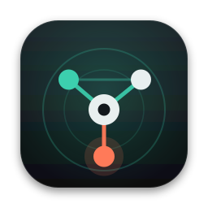
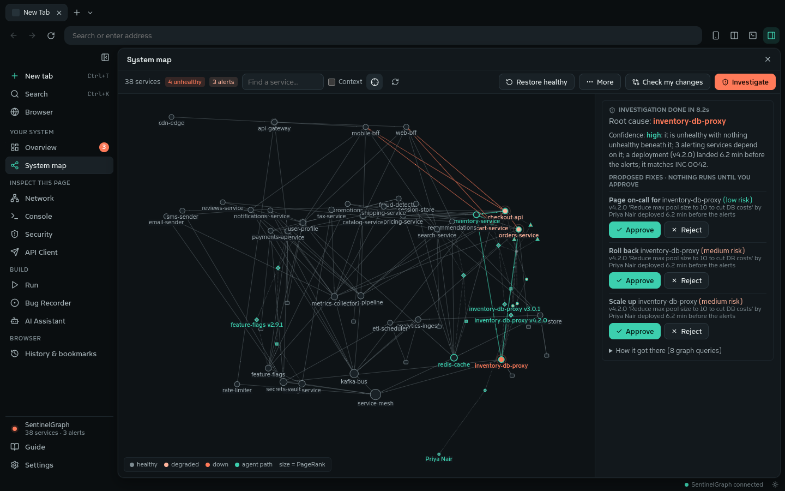
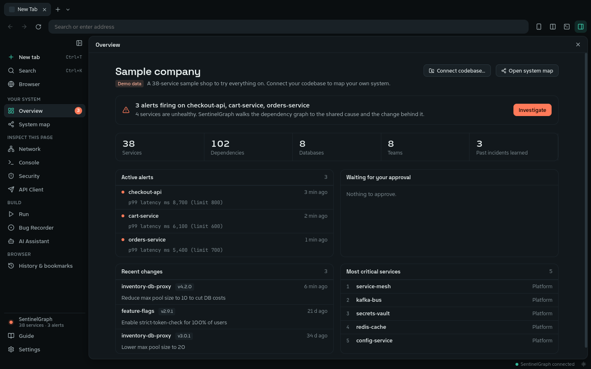

<p align="center">
  
</p>

<h1 align="center">DevBrowser</h1>

<p align="center">
  The browser for people who build and run software.<br>
  Inspect any page, see how your services connect, and find the cause of a failure in seconds.
</p>

---

DevBrowser is a desktop browser for developers. It does what you expect of a browser, and it adds the tools you
would otherwise open in five other windows: a network inspector, a passive security audit, an API client, and a
live map of how the services behind your app depend on each other.

The map is powered by **SentinelGraph**, a small server that reads your codebase and your traffic, keeps the result
as a graph, and answers the question every on-call engineer asks first: *of everything that is alerting, what is
actually broken, what changed, and who owns it?*

## What you get

| | |
| :--- | :--- |
| **A real browser** | Tabs, split view, separate profiles, device emulation, find, zoom, session restore. Dev servers are one click away (`:3000`, `:5173`, ...). |
| **Inspect as you browse** | Network (with a real timing waterfall), Security, an API client that really sends requests, and a local AI assistant dock beside the page. Network and Security show the website you are on, with History for everything before. |
| **A map of your system** | Point DevBrowser at a repository. Services, databases, outside APIs and the connections between them appear; for a monorepo, its packages; for a single app, its modules and their imports. Works on microservices, monorepos, mobile apps and libraries in every common language. |
| **Root cause, not symptoms** | Break something (or have something break) and press **Investigate**. The agent walks the graph to the shared dependency, names the change that caused it, and proposes a fix. It handles databases and several simultaneous failures, and says how sure it is. |
| **Know the blast radius before you merge** | **Check my changes** shows which services your uncommitted work touches and what depends on them; the same check comments on pull requests in CI. |
| **You stay in charge** | The agent can only *propose*. Nothing is rolled back, scaled or paged until you approve it. |
| **Easy to find your way** | A labelled sidebar grouped by what you are doing, a **Guide** that explains the whole product with a *Try it* button per journey, and `⌘K` / `Ctrl+K` to search every action by name. |

<p align="center">
  
</p>

<p align="center">
  
</p>

## Quick start

Requirements: Node.js 20 or 22 and Python 3.12. From the repository root:

```bash
make demo     # DevBrowser + its own SentinelGraph, on a clean 38-service sample company with a live incident to investigate
make dev      # DevBrowser on your own projects
```

The first run installs what it needs (`make setup`). DevBrowser starts SentinelGraph by itself on `127.0.0.1:8100` and stops it
when you quit: there is no separate backend to run. The graph is embedded: no database server, no cloud account.

Then, in the app: **Overview** shows your system's health and what changed. **Connect codebase…** maps your own repository.
On the **System map**, pick a service, **Ship a bad deploy**, then **Investigate**: the agent names the root cause and the
change behind it, and proposes fixes that wait for your approval. New here? Open **Guide** at the bottom of the sidebar.

## Install

The installers on the [latest release](../../releases/latest) are **1.2.0**; this README describes **1.3.0**, which runs from
source (above) until the next release is published. Download the installer for your system for your system from the [latest release](../../releases/latest):

| System | File |
| :--- | :--- |
| macOS, Apple Silicon | `DevBrowser-<version>-mac-arm64.dmg` |
| macOS, Intel | `DevBrowser-<version>-mac-x64.dmg` |
| Windows | `DevBrowser-Setup-<version>-x64.exe` (or `-Portable-` for no install) |
| Linux | `DevBrowser-<version>-linux-<arch>.AppImage` or `.deb` |

A release build connects by itself to a hosted SentinelGraph demo (a sample company with real failures to investigate), so the system map
works the first time you open it. To map **your own** code, run SentinelGraph on your machine ([Getting started](docs/GETTING_STARTED.md#2-run-sentinelgraph)).

The installers are not code-signed, so macOS and Windows warn you once:

- **macOS:** open the `.dmg`, drag DevBrowser to Applications, then **right-click the app > Open > Open**. If macOS says the app is
  "damaged", run `xattr -dr com.apple.quarantine /Applications/DevBrowser.app` once and open it again.
- **Windows:** **More info > Run anyway** on the blue SmartScreen screen.

More in [Getting started](docs/GETTING_STARTED.md#first-launch).

## Documentation

| | |
| :--- | :--- |
| [Getting started](docs/GETTING_STARTED.md) | Install, first launch, run the server, connect a project |
| [User guide](docs/USER_GUIDE.md) | Every feature, shortcuts, troubleshooting |
| [Testing in the real world](docs/TESTING.md) | A test plan you can run today on your own code, a map-accuracy benchmark, and the results we got |
| [Security and privacy](docs/SECURITY.md) | What the app and the server can see and do, and what they never send |
| [Product overview](docs/PRODUCT.md) | What problem this solves and why it matters, with sourced numbers |
| [Architecture](docs/ARCHITECTURE.md) | How it is built |
| [Releasing](docs/RELEASING.md) | Building installers, signing, publishing |
| [Changelog](CHANGELOG.md) | What changed |

## What you can do, start to finish

The same five journeys are in the app itself: **Guide**, at the bottom of the sidebar, with a *Try it* button for each.

| Journey | How |
| :--- | :--- |
| **Open your app and see what it does** | **Run** starts your dev server and opens its page; **Network**, **Console** and **Security** show what that page does. |
| **Map your codebase** | **Connect codebase…** → **Overview** (what was found) → **System map** (how it connects). |
| **Find out why something broke** | Alerts appear on **Overview** → **Investigate** → root cause, the change behind it, its owner → approve or reject the proposed fixes. |
| **Check a change before you merge** | **Check my changes**: which services your uncommitted work touches and everything that depends on them. |
| **Hand a bug to a teammate** | **Bug Recorder** → one file of clicks, requests and errors → they replay it and see whether it reproduces. |

Every action is also one search away: `⌘K` / `Ctrl+K`.

## What it reads from your code

No diagrams to draw, nothing to annotate. From a repository SentinelGraph reads:

- **Docker Compose** and **Kubernetes manifests**: services, databases, and who depends on whom (including `${VARIABLES}` from `.env`).
- **Declared workspaces**: npm, Yarn and pnpm workspaces, Gradle (Android, Kotlin, Java), Swift Package Manager, Cargo, Maven,
  .NET solutions and Go workspaces, with the dependencies between packages their manifests declare.
- **Source imports**: for a single app, its modules and which uses which, in TypeScript, JavaScript, Svelte, Vue, Python, Go,
  Java, Kotlin, Swift, Rust, Ruby, PHP, C# and more, plus the databases and outside APIs each module uses.
- **CODEOWNERS**: who owns what. **Git history**: which commit touched which service, and who wrote it.
- **OpenTelemetry traces** and **your own browsing**: the calls that really happen at runtime.

A folder with no code is refused with a reason rather than mapped as a made-up app. The **codebase sandbox**
(`sandbox/codebases.py`) checks all of this against 20 public repositories of every shape: currently 20 of 20 map as
expected, each in under half a second.

## Every command

| | |
| :--- | :--- |
| `make demo` | The demo: DevBrowser with its own SentinelGraph on a clean 38-service sample company |
| `make dev` | DevBrowser from source, on your own connected project |
| `make test` | Unit tests: the server (Python) and the app (TypeScript), plus type checks and lint |
| `make e2e` | The real, built app driven end to end against a live microservice shop (starts and stops the shop) |
| `make codebases` | The codebase sandbox: scan 20 real repositories |

## Project layout

```
DevBrowser/   the desktop app (Electron, React, TypeScript); starts SentinelGraph itself
backend/      SentinelGraph server (Python, FastAPI), its embedded graph engine and graph tools
sandbox/      a live microservice shop to try everything on (run.py), and the codebase sandbox (codebases.py)
e2e/          end-to-end tests that drive the real, built app
docs/         documentation
scripts/      launchers: demo.sh (the demo), sentinelgraph.sh (the server alone)
Makefile      every task as one command: setup, demo, dev, test, e2e, codebases
```

## Build from source

```bash
cd DevBrowser
npm ci
npm run dev          # run from source (starts SentinelGraph too; `make setup` once creates backend/.venv)
npm test             # unit tests
npm run dist         # installers for this OS, in DevBrowser/release/
```

## Licence

MIT. See [LICENSE](LICENSE).
