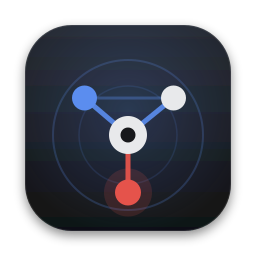
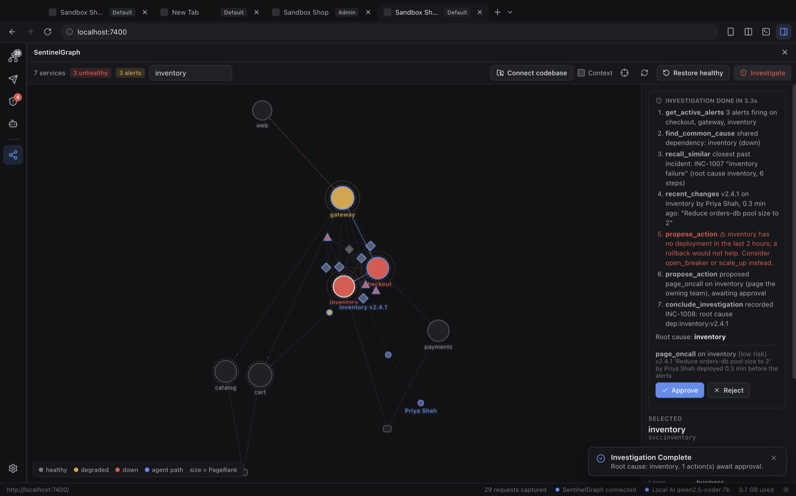

<p align="center">
  
</p>

<h1 align="center">DevBrowser</h1>

<p align="center">
  The browser for people who build and run software.<br>
  Inspect any page, see how your services connect, and find the cause of a failure in seconds.
</p>

---

DevBrowser is a desktop browser for developers. It does what you expect of a browser, and it adds the tools you
would otherwise open in five other windows: a network inspector, a passive security audit, an API client, and a
live map of how the services behind your app depend on each other.

The map is powered by **SentinelGraph**, a small server that reads your codebase and your traffic, keeps the result
as a graph, and answers the question every on-call engineer asks first: *of everything that is alerting, what is
actually broken, what changed, and who owns it?*

## What you get

| | |
| :--- | :--- |
| **A real browser** | Tabs, split view, separate profiles, device emulation, find, zoom, session restore. Dev servers are one click away (`:3000`, `:5173`, ...). |
| **Inspect as you browse** | Network, Security and API Client panels dock beside the page. They show the website you are on, with History for everything before. |
| **A map of your system** | Point DevBrowser at a repository. Services, databases, outside APIs and the connections between them appear; for a monolith, its modules and their imports. |
| **Root cause, not symptoms** | Break something (or have something break) and press **Investigate**. The agent walks the graph to the one shared dependency, names the change that caused it, and proposes a fix. |
| **You stay in charge** | The agent can only *propose*. Nothing is rolled back, scaled or paged until you approve it. |

<p align="center">
  
</p>

## Install

Download the installer for your system from the [latest release](../../releases/latest):

| System | File |
| :--- | :--- |
| macOS, Apple Silicon | `DevBrowser-<version>-mac-arm64.dmg` |
| macOS, Intel | `DevBrowser-<version>-mac-x64.dmg` |
| Windows | `DevBrowser-Setup-<version>-x64.exe` (or `-Portable-` for no install) |
| Linux | `DevBrowser-<version>-linux-<arch>.AppImage` or `.deb` |

The first release is not code-signed yet, so macOS and Windows will warn you once. The steps are in
[Getting started](docs/GETTING_STARTED.md#first-launch).

## Five minutes to your first map

1. Start SentinelGraph on your machine: `./scripts/sentinelgraph.sh` (or Docker, see [Getting started](docs/GETTING_STARTED.md)).
2. Open DevBrowser. On the new-tab page choose **Connect SentinelGraph**, enter `http://127.0.0.1:8100`.
3. Click **Connect codebase…** and pick a repository folder.
4. Open the SentinelGraph panel. Type a service name in **Find a service**, choose **Crash it**, then **Investigate**.

## Documentation

| | |
| :--- | :--- |
| [Getting started](docs/GETTING_STARTED.md) | Install, first launch, run the server, connect a project |
| [User guide](docs/USER_GUIDE.md) | Every feature, shortcuts, troubleshooting |
| [Testing in the real world](docs/TESTING.md) | A test plan you can run today on your own code, with the results we got |
| [Security and privacy](docs/SECURITY.md) | What the app and the server can see and do, and what they never send |
| [Product overview](docs/PRODUCT.md) | What problem this solves and why it matters, with sourced numbers |
| [Architecture](docs/ARCHITECTURE.md) | How it is built |
| [Releasing](docs/RELEASING.md) | Building installers, signing, publishing |
| [Changelog](CHANGELOG.md) | What changed |

## What it reads from your code

No diagrams to draw, nothing to annotate. From a repository SentinelGraph reads:

- **Docker Compose** and **Kubernetes manifests**: services, databases, and who depends on whom (including `${VARIABLES}` from `.env`).
- **Source imports** (TypeScript, JavaScript, Python): the modules of a monolith and which call which, plus the databases and outside APIs each one uses.
- **CODEOWNERS**: who owns what. **Git history**: which commit touched which service, and who wrote it.
- **OpenTelemetry traces** and **your own browsing**: the calls that really happen at runtime.

## Project layout

```
DevBrowser/   the desktop app (Electron, React, TypeScript)
backend/      SentinelGraph server (Python, FastAPI) and its graph tools
frontend/     optional web dashboard (Next.js)
sandbox/      a small live microservice shop for trying everything on your machine
e2e/          end-to-end tests that drive the real, built app
docs/         documentation
scripts/      one-command launchers
```

## Build from source

```bash
cd DevBrowser
npm ci
npm run dev          # run from source
npm test             # unit tests
npm run dist         # installers for this OS, in DevBrowser/release/
```

Requirements: Node.js 20 or 22, and Python 3.12 for the server.

## Licence

MIT. See [LICENSE](LICENSE).
