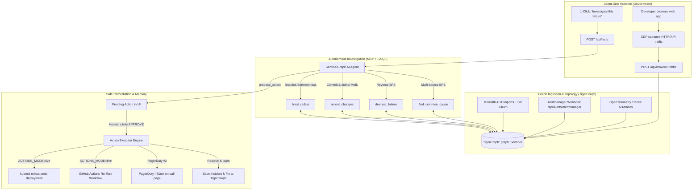
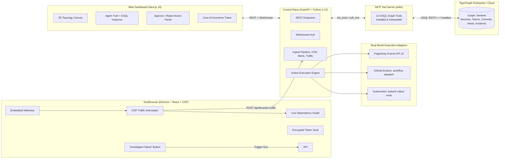
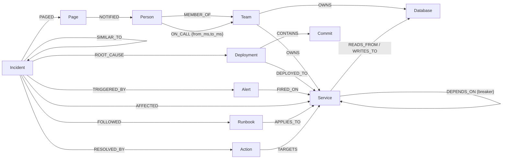

# 🛡️ graphxDevBrowser

> **Autonomous Graph-Native Incident Remediation & Developer Telemetry Platform powered by TigerGraph**

**graphxDevBrowser** bridges client-side developer runtime inspection (**DevBrowser**) with deep, graph-native distributed systems observability and autonomous incident remediation (**SentinelGraph** on TigerGraph).

When production breaks, graphxDevBrowser walks live dependency paths in **TigerGraph GSQL**, isolates the exact root cause in seconds, proposes safe remediation, executes real rollbacks (Kubernetes or GitHub Actions) with human approval, and permanently saves incident memory.

---

## ⚡ The 30-Second Tour



1. **Traffic & Dependency Capture**: DevBrowser intercepts all browser network requests over Chrome DevTools Protocol (CDP) and batches them to TigerGraph. Every frontend endpoint automatically maps to its backend services, databases, and third-party dependencies.
2. **Alert Fires**: When a bad deploy lands (or simulated chaos strikes), alerts fire on upstream services (`checkout-api`, `cart-service`, `orders-service`).
3. **Autonomous Agent Traversal**: The SentinelGraph agent executes GSQL tools over TigerGraph via MCP. In under a minute, it traverses multi-hop paths to locate the single shared broken dependency, identifies the recent commit and its author, and computes blast radius.
4. **Human-in-the-Loop Safe Execution**: The agent cannot mutate infrastructure directly. It proposes an action (`rollback`, `open_breaker`, `scale_up`, `page_oncall`). A human approves with one click.
5. **Real Infrastructure Remediation**: The backend action adapter executes the fix via `KubernetesExecutor` (`kubectl rollout undo`) or `GitHubExecutor` (workflow dispatch), notifies on-call responders via PagerDuty v2, and marks the incident resolved.
6. **Incident Memory**: The incident, its root cause, and the fix are committed back to the TigerGraph graph. On future similar incidents, graph traversal recalls the fix immediately.

---

## 💡 Why a Graph?

Traditional APM dashboards (Datadog, Grafana, PagerDuty) view metrics per service. When 5 services alert simultaneously, finding which one is the culprit requires jumping across dashboards, traces, git logs, and Slack channels—taking 30 to 90 minutes.

"Checkout, cart, and orders are all failing" is not a text search problem; it is a **graph path traversal problem**:

| The On-Call Engineer's Question | How graphxDevBrowser Answers It in TigerGraph (GSQL) |
| :--- | :--- |
| **What do all alerting services depend on?** | Multi-source BFS down `DEPENDS_ON` (≤ 5 hops) from every alerting service, tracking hop counts in a `MapAccum`. Candidates are nodes reached by all sources. |
| **Which shared dependency caused the failure?** | Reverse BFS up `reverse_DEPENDS_ON` from all unhealthy services: ranks unhealthy candidates that have **nothing unhealthy beneath them** (the deepest failure). |
| **Who is on-call right now?** | Multi-hop traversal: `Service <-OWNS- Team <-ON_CALL {from_ms, to_ms}- Person`. |
| **What is the blast radius and impact?** | Reverse BFS reachability + GSQL PageRank + Brandes Betweenness Centrality. |
| **Have we seen this failure pattern before?** | Traversal of past `Incident` vertices within 2 hops downstream of affected services, weighted by proximity. |

---

## 🏛️ System Architecture



---

## 🧩 Graph Data Model

The schema is defined in [`backend/sentinel/schema.py`](backend/sentinel/schema.py) and operates within its own dedicated TigerGraph graph (`Sentinel`, `Sentinel_test`, `Sandbox`, etc.).



### Vertex Types
- **`Service`**: `name`, `kind` (`service` \| `module`), `tier` (`critical` \| `high` \| `medium` \| `low`), `status` (`healthy` \| `degraded` \| `down`), `layer`
- **`Deployment` & `Commit`**: `version`, `at`, `status` (`live` \| `rolled_back`), `sha`, `message`, `files`
- **`Team` & `Person`**: `name`, `slack_channel`, `role`, `handle`, `on_call` time windows
- **`Alert`**: `metric`, `value`, `threshold`, `status` (`firing` \| `resolved`)
- **`Incident`**: `title`, `status` (`investigating` \| `mitigating` \| `resolved`), `summary`, `steps_taken`, `learned`
- **`Action`**: `kind` (`rollback` \| `open_breaker` \| `scale_up` \| `page_oncall`), `status` (`pending` \| `executed` \| `rejected`), `target_name`, `reason`, `risk`
- **`Runbook` & `Page`**: `title`, `steps`, `message`, `channel`

---

## 🛠️ The 12 GSQL Agent Tools

The autonomous agent interacts with TigerGraph purely through the Model Context Protocol (MCP) using 12 GSQL tools:

1. **`get_active_alerts`**: Retrieves all currently firing alerts across the topology.
2. **`find_common_cause`**: Multi-source BFS up to 5 hops finding services reachable from all alerting nodes.
3. **`deepest_failure`**: Reverse BFS identifying unhealthy nodes that have no unhealthy downstream callers (the root cause).
5. **`blast_radius`**: Reverse BFS determining the upstream cascade and calculating total revenue-at-risk.
6. **`service_context`**: Comprehensive vertex inspection: owner team, on-call engineer, database dependencies, open circuit breakers.
7. **`recall_similar`**: Weighted graph traversal over historical `Incident` vertices and their resolutions.
8. **`critical_services`**: PageRank analysis identifying top topological bottlenecks in the network.
9. **`chokepoints`**: Brandes Betweenness Centrality identifying critical bridges.
10. **`propose_action`**: Creates a pending `Action` node (rollback, circuit breaker, scale up, page). Does not execute until human approval.
11. **`page_oncall`**: Formats and triggers paging notification to the on-call person.
12. **`conclude_investigation`**: Finalizes findings, generates structured postmortem, and commits learned patterns to graph memory.

---

## 🖥️ DevBrowser: Developer Client

DevBrowser (`DevBrowser/`) is an Electron desktop runtime that brings TigerGraph's graph intelligence straight into the developer's daily workflow:

- **CDP Network Interceptor**: Captures all HTTP requests, status codes, and timings directly from Chrome DevTools Protocol.
- **Automatic Graph Mapping**: Streams captured endpoints to `/api/browser-traffic`, dynamically linking `web:<host>` dependencies to backend services in TigerGraph.
- **Interactive Dependencies View**: Visualizes upstream/downstream blast radius using TigerGraph graph algorithms directly inside the browser.
- **1-Click Incident Investigation**: When an API returns 5xx or fails, click **"Investigate this failure"** to trigger an autonomous SentinelGraph investigation and view live root-cause analysis.
- **Encrypted Credential Vault**: Secures API tokens and environment variables locally using OS-level encrypted vaults (`safeStorage`).

---

## 🧪 Try It Live in 2 Minutes (no cloud account)

```bash
cd backend && python -m venv .venv && .venv/bin/pip install -r requirements.txt && cd ..
backend/.venv/bin/python sandbox/run.py up        # API + a live microservice shop + traffic
backend/.venv/bin/python sandbox/run.py demo      # break inventory, investigate, approve rollback, verify
```

The [sandbox](sandbox/README.md) runs the whole product on your machine: a real 7-service shop sending
OpenTelemetry traces, the agent, real (sandboxed) rollbacks, and DevBrowser on top. SentinelGraph runs on its
embedded graph engine there (`GRAPH_BACKEND=local`, see below), so it needs no TigerGraph, LLM key or Docker.

## 🗺️ Point It at Your Codebase

```bash
python -m sentinel.ingest codebase /path/to/your/repo              # writes the graph directly
python -m sentinel.ingest codebase . --push https://sentinel.example.com   # or sends it to a running API
```

The scan reads what the repository already declares: services, datastores and dependencies from Docker Compose
(`depends_on` and service URLs in the environment), owners from `CODEOWNERS`, language from each build context,
tier/revenue/layer from compose labels (`sentinel.tier: critical`), and recent changes from git. It also records
every address each service answers on, so traffic DevBrowser captures to `localhost:7404` lands on the same
`checkout` vertex as its traces and its code. Re-scanning never resets runtime health. Without a compose file,
each package directory (`services/*`, `apps/*`, ...) becomes a service and traces fill in the dependencies.

## 🔌 How DevBrowser and SentinelGraph Work Together

| In DevBrowser | What SentinelGraph does |
| :--- | :--- |
| Browse your app | Captured API calls become dependencies (`POST /api/browser-traffic`). Topology only: a developer clicking around never changes health or pages anyone. |
| Select a request in the Network panel | `GET /api/resolve?url=`: the service behind it, owner team, on-call, health, blast radius, recent changes. |
| **Investigate this failure** on a 5xx | `POST /api/runs` with the request as evidence: it becomes a health signal, and the agent starts from it but follows the graph to the real origin. |
| Watch the run, **Approve** / **Reject** | `GET /api/runs/current` (scoped to the run), `POST /api/actions/{uid}/approve`. |
| Restart the app | The connection is restored. |

## ⚙️ Graph Engines

| `GRAPH_BACKEND` | Use | Notes |
| :--- | :--- | :--- |
| `tigergraph` (default when `TG_HOST` is set) | Teams, production | Multi-hop GSQL on TigerGraph Cloud or self-hosted. |
| `local` (default otherwise) | Sandbox, single developer, CI | `sentinel/localgraph.py`: the same pyTigerGraph calls and all 15 GSQL queries in Python, file-backed (`LOCAL_GRAPH_DIR`) so the API and the agent's MCP subprocess share it. Sized for one team's topology. A test fails if a GSQL query has no local implementation. |

Trace health fails fast and recovers slowly: an alert resolves only after the service has looked healthy for
`OTEL_RECOVERY_MS` (15 s), so one lucky window in a noisy stream doesn't close an incident.

## 🚀 Getting Started

### Prerequisites
- **Node.js**: v20 or v22 LTS
- **Python**: v3.12+
- **TigerGraph**: TigerGraph Cloud instance (or local TigerGraph 4.x)

### 1. Environment Setup
Copy the example environment file and configure your TigerGraph credentials:

```bash
cp .env.example .env
```

Key variables in `.env`:
```ini
TG_HOST=https://your-instance.i.tgcloud.io
TG_GRAPH=Sentinel
TG_SECRET=your-tigergraph-secret
ACTIONS_MODE=dry-run   # change to 'live' for real Kubernetes/GitHub execution
ACTION_ADAPTER=auto    # 'kubernetes', 'github', or 'auto'
LLM_PROVIDER=gemini    # 'gemini', 'openai', or 'autopilot'
GEMINI_API_KEY=your-api-key
```

### 2. Backend API & MCP Server
```bash
cd backend
python -m venv .venv
source .venv/bin/activate
pip install -r requirements.txt

# Seed the TigerGraph graph (seed 42 demo company)
python -m sentinel.seed --reset

# Run FastAPI backend
uvicorn sentinel.api.main:app --port 8100 --reload
```

### 3. Frontend Web Dashboard
```bash
cd frontend
npm install
npm run dev -- -p 3001
```
Open [http://localhost:3001](http://localhost:3001) to view the live 3D dependency topology and agent trail.

### 4. DevBrowser Desktop App
```bash
cd DevBrowser
npm install
npm run dev
```
In DevBrowser, navigate to **Settings → Integrations → SentinelGraph**, enter `http://localhost:8100`, then click **Connect & Load Graph**.

---

## 🔄 Ingestion & Webhooks

### 1. Prometheus Alertmanager
Configure your Prometheus Alertmanager to send webhooks directly to SentinelGraph:
```yaml
receivers:
  - name: 'sentinelgraph'
    webhook_configs:
      - url: 'http://<sentinel-host>:8100/api/alerts/alertmanager'
        send_resolved: true
```

### 2. OpenTelemetry Traces
Point OpenTelemetry Collector to graphxDevBrowser:
```yaml
exporters:
  otlphttp/sentinel:
    traces_endpoint: http://<sentinel-host>:8100/v1/traces
    encoding: json
service:
  pipelines:
    traces:
      receivers: [otlp]
      exporters: [otlphttp/sentinel]
```

### 3. CI/CD Deployment Markers
Record deploys from GitHub Actions, GitLab CI, or Jenkins:
```bash
curl -X POST http://localhost:8100/api/changes \
  -H "Content-Type: application/json" \
  -d '{
    "service": "inventory-db-proxy",
    "version": "v4.2.1",
    "author": "Alice Developer",
    "sha": "9be56d0",
    "message": "Scale connection pool to 50"
  }'
```

---

## 🧪 Testing

### Backend Unit & Integration Tests (pytest)
```bash
cd backend
GRAPH_BACKEND=local .venv/bin/python -m pytest -q          # hermetic, ~20 s (what every PR runs)
GRAPH_BACKEND=tigergraph .venv/bin/python -m pytest -q     # against TigerGraph (graph Sentinel_test), ~15 min
```

### Live Sandbox (the product end to end)
```bash
backend/.venv/bin/python sandbox/run.py up &
for s in web gateway catalog cart checkout payments inventory; do backend/.venv/bin/python sandbox/run.py demo $s; done
cd DevBrowser && SENTINEL_SANDBOX=1 SENTINEL_URL=http://localhost:8200 npx vitest run
```

### DevBrowser Unit & Integration Tests (vitest)
```bash
cd DevBrowser
npm run typecheck
npm run lint
npm test
```

### Full Stack End-to-End Tests (Playwright)
```bash
cd e2e
npm install
npx playwright install chromium
npx playwright test   # against a running API (:8100) + dashboard (:3001)
```

---

## 📁 Repository Structure

```
graphxDevBrowser/
├── backend/                  # Python 3.12 FastAPI backend & MCP server
│   ├── sentinel/
│   │   ├── schema.py         # TigerGraph schema definition & reverse edges
│   │   ├── db.py             # Connection pooling, token auth, GSQL execution
│   │   ├── config.py         # Configuration & environment variables
│   │   ├── mcp_server.py     # 12 GSQL tools exposed via Model Context Protocol
│   │   ├── tools/            # GSQL traversal algorithms, actions, health, memory
│   │   ├── ingest/           # OpenTelemetry, Alertmanager, Monolith, DevBrowser traffic
│   │   ├── seed/             # Topology generator, historical commits, chaos scenarios
│   │   ├── agent/            # Autonomous LLM loop, prompts, autopilot mode
│   │   └── api/              # FastAPI REST endpoints & WebSocket hub
│   └── tests/                # Test suites against live TigerGraph
├── frontend/                 # Next.js 16 Web Dashboard
│   ├── src/                  # Topology Canvas, Agent Trail, Action Controls
│   └── public/               # Static assets & icons
├── DevBrowser/               # Electron Developer Browser
│   ├── src/main/             # CDP network interceptor, IPC bridge, encrypted vault
│   ├── src/preload/          # Safe API bridge for renderer
│   ├── src/renderer/         # React UI, Dependency View, Traffic Inspector
│   └── tests/                # Vitest unit & integration test suites
├── sandbox/                  # Live sandbox: a traced 7-service shop + one-command launcher and checks
├── e2e/                      # Playwright End-to-End test suites
├── docs/                     # Architecture diagrams, demo scripts, blog posts
├── docker-compose.yml        # Multi-container orchestration
└── render.yaml               # Cloud deployment blueprint
```

---

## 📄 License

MIT © 2026 graphxDevBrowser contributors.
