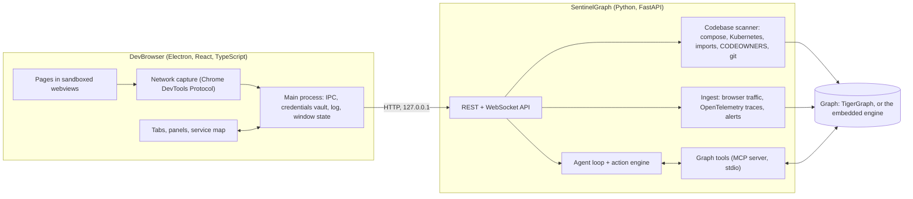
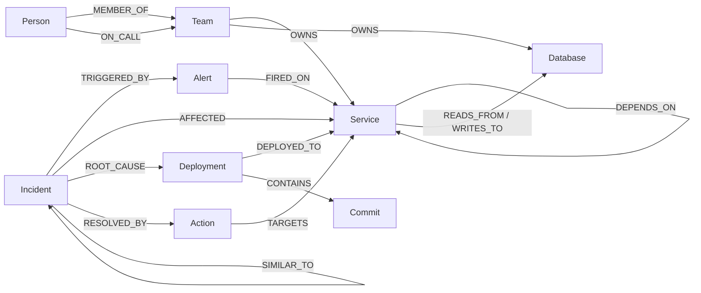

# Architecture

## The pieces

- **The app** never talks to the graph directly. Its main process holds the connection to the server and exposes a
  small typed API to the interface (`src/preload`), so the interface and the pages cannot reach Node, the file system
  or the credentials.
- **The server** builds the graph (scanner and ingest), and answers questions about it through thirteen graph tools. The
  agent is a loop that calls only those tools; it cannot write to the graph except by *proposing* an action.
- **The graph** is TigerGraph (GSQL, multi-hop traversal and graph algorithms) when `TG_HOST` is set, otherwise an
  embedded engine with the same query surface, so the whole product runs on one laptop with no cloud account.

## Data flow

| What | Path |
| :--- | :--- |
| A repository becomes a map | folder picked in the app, `POST /api/workspace/scan {path}`, scanner builds a manifest, applied to the graph. A different repository replaces the graph; the same one updates it and keeps live health. |
| Browsing becomes dependencies | CDP captures a request, the main process strips the query string, batches records, `POST /api/browser-traffic`, topology only (it never changes health). |
| A failure becomes a diagnosis | `POST /api/runs` starts the agent; each tool call and its query streams to the app; `GET /api/runs/current`. |
| A proposal becomes a change | `POST /api/actions/{uid}/approve` runs the configured adapter (dry-run by default). |

## What the scanner reads

| Source | Gives |
| :--- | :--- |
| Docker Compose (with `.env`, in the root or `deploy/`, `docker/`, …) | services, databases, `depends_on`, service URLs in environment variables, published ports (so browser traffic to `localhost:7004` lands on the right service) |
| Kubernetes manifests | Deployments and StatefulSets as services, Services for ports and exposure, environment values that name another workload |
| Source imports (TypeScript, JavaScript, Python) | for a monolith: modules, module-to-module imports (with `tsconfig` path aliases), databases (Prisma, `pg`, …) and outside APIs (SDKs, API hosts, environment variables actually used) |
| `CODEOWNERS`, git log | owners, and which commit touched which service or module |
| Name heuristics | monitoring, load generators, feature-flag servers and one-shot jobs are left out; stores such as `*-db`, `mysql`, `kafka` are databases |

A service built from the repository root with no folder of its own is treated as a monolith, and replaced by its modules.

## The graph model

A `Service` has a `kind`: `service`, `module` (inside a monolith) or `external` (an outside API). The schema is in
`backend/sentinel/schema.py`, with a longer description in [data-model.md](data-model.md).

## The thirteen graph tools

`get_active_alerts`, `get_service_context`, `trace_dependencies`, `blast_radius`, `find_common_cause`,
`recent_changes`, `critical_services`, `chokepoints`, `failure_path`, `find_root_causes`, `recall_similar`, `propose_action`,
`conclude_investigation`.

`find_common_cause` is a multi-source search from every alerting service down the dependency edges, and ranks the
shared dependency that is itself unhealthy with nothing unhealthy beneath it. `blast_radius` walks the edges the other
way. `critical_services` (PageRank) and `chokepoints` (betweenness) say how important a service is. `recall_similar`
looks at past incidents near the affected services; `conclude_investigation` stores the result so the next, similar one
is solved faster.

By default the agent is deterministic (the same graph gives the same answer, no model needed). With
`LLM_PROVIDER=ollama|gemini|openai` a model chooses the tool calls instead, with the deterministic agent as the fallback.

## Isolation and safety

See [Security](SECURITY.md). In short: pages are sandboxed with no Node access, the interface is isolated behind a typed
bridge, secrets are encrypted by the operating system, the server listens on loopback only, and every state-changing
action waits for a person.

## Build and packaging

Vite builds the interface and the main process; `electron-builder` packages them (the installer contains only the built
files, no `node_modules`). The first screen's code is small; each tool panel is loaded when first opened. See
[Releasing](RELEASING.md). End-to-end tests drive the real built or installed app with Playwright.
