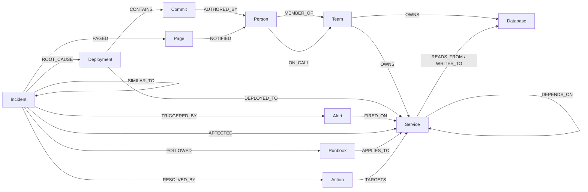

# Graph data model

SentinelGraph keeps **everything in one TigerGraph graph** (`Sentinel`): the infrastructure, its change history,
the people who own it, live alerts, and the memory of past incidents. Because memory lives next to the services it
touched, "have we seen this before?" is a graph traversal, not a text search.

Every vertex's **primary id** is a stable string **`uid`** (`svc:checkout-api`, `dep:inventory-db-proxy:v4.2.0`,
…), also readable as an attribute (`primary_id_as_attribute`). Tools and the UI refer to vertices by `uid`.
The schema is local to the graph and defined in [`backend/sentinel/schema.py`](../backend/sentinel/schema.py); every
edge type has a reverse edge `reverse_<NAME>` so GSQL can traverse it against the arrow.

## Vertices

| Type | uid | Key attributes |
| :--- | :--- | :--- |
| `Team` | `team:<slug>` | `name`, `domain`, `slack_channel` |
| `Person` | `person:<handle>` | `name`, `role`, `handle` |
| `Service` | `svc:<name>` | `name`, `kind` (service, or module for a monolith), `tier` (critical/high/medium/low), `status` (healthy/degraded/down), `root_fault`, `layer`, `language`, `version`, `revenue_per_min` |
| `Database` | `db:<name>` | `name`, `engine`, `size_gb`, `status` |
| `Deployment` | `dep:<service>:<version>` | `version`, `at` (epoch ms), `status` (live/rolled_back), `change_summary`, `origin` (scenario/ingest/git/sandbox) |
| `Commit` | `commit:<sha>` | `sha`, `message`, `files_changed`, `files` (newline-separated paths, from git) |
| `Alert` | `alert:<id>` | `id`, `metric`, `value`, `threshold`, `at`, `status` (firing/resolved) |
| `Incident` | `inc:<id>` | `id`, `title`, `severity`, `status` (investigating/mitigating/resolved/abandoned), `opened_at`, `resolved_at`, `summary`, `steps_taken`, `run_id`, `learned` |
| `Action` | `act:<id>` | `kind` (rollback/open_breaker/page_oncall/scale_up), `status` (pending/executing/executed/rejected/failed/expired), `target_name` (`target` is reserved in GSQL), `target_uid`, `reason`, `risk` |
| `Runbook` | `rb:<slug>` | `title`, `steps` |
| `Page` | `page:<id>` | `at`, `message`, `channel` |

## Edges (all directed)

| Pattern | Attributes | Meaning |
| :--- | :--- | :--- |
| `(Team)-[:OWNS]->(Service\|Database)` | | Ownership |
| `(Person)-[:MEMBER_OF]->(Team)` | | |
| `(Person)-[:ON_CALL]->(Team)` | `from_ms`, `to_ms` (epoch ms) | On call while `from_ms <= now < to_ms`. Windows are re-centred on the current time when the API starts and on every reset/scenario, so they never run out |
| `(Service)-[:DEPENDS_ON]->(Service)` | `uid`, `protocol`, `weight`, `latency_ms`, `breaker` (closed/open) | **A depends on B**, so failure flows *against* the arrow |
| `(Service)-[:READS_FROM\|WRITES_TO]->(Database)` | `uid` | |
| `(Deployment)-[:DEPLOYED_TO]->(Service)` | | |
| `(Deployment)-[:CONTAINS]->(Commit)` | | |
| `(Commit)-[:AUTHORED_BY]->(Person)` | | |
| `(Alert)-[:FIRED_ON]->(Service)` | | |
| `(Incident)-[:TRIGGERED_BY]->(Alert)` | | |
| `(Incident)-[:AFFECTED]->(Service)` | | |
| `(Incident)-[:ROOT_CAUSE]->(Deployment\|Service)` | | |
| `(Incident)-[:RESOLVED_BY]->(Action)` | | |
| `(Incident)-[:SIMILAR_TO]->(Incident)` | `score`, `reason` | Memory link |
| `(Incident)-[:FOLLOWED]->(Runbook)` | | |
| `(Runbook)-[:APPLIES_TO]->(Service)` | | Procedural memory |
| `(Action)-[:TARGETS]->(Service\|Deployment)` | | Audit trail |
| `(Incident)-[:PAGED]->(Page)` | | Pages sent during the incident |
| `(Page)-[:NOTIFIED]->(Person)` | | |

> **Direction:** `(checkout-api)-[:DEPENDS_ON]->(inventory-db-proxy)`. The blast radius of a broken `X` is everything
> that reaches `X` by following `DEPENDS_ON` forwards, i.e. a breadth-first search from `X` over `reverse_DEPENDS_ON`
> (GSQL `-(<DEPENDS_ON)-`), up to 6 hops.

## Why a graph

The questions an on-call engineer asks are path questions:

- *What do all the alerting services have in common downstream?* → multi-source breadth-first search with per-source hop counts
- *What changed on that path in the last hour, and who wrote it?* → `Deployment → Commit → Person`
- *Who is on call for the owner?* → `Service ← OWNS ← Team ← ON_CALL ← Person`
- *How much breaks if it stays down?* → reverse traversal + PageRank / betweenness
- *Have we seen this before?* → incidents within two hops of the affected services
